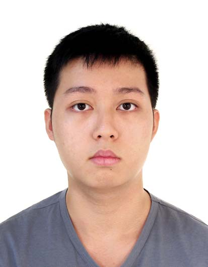
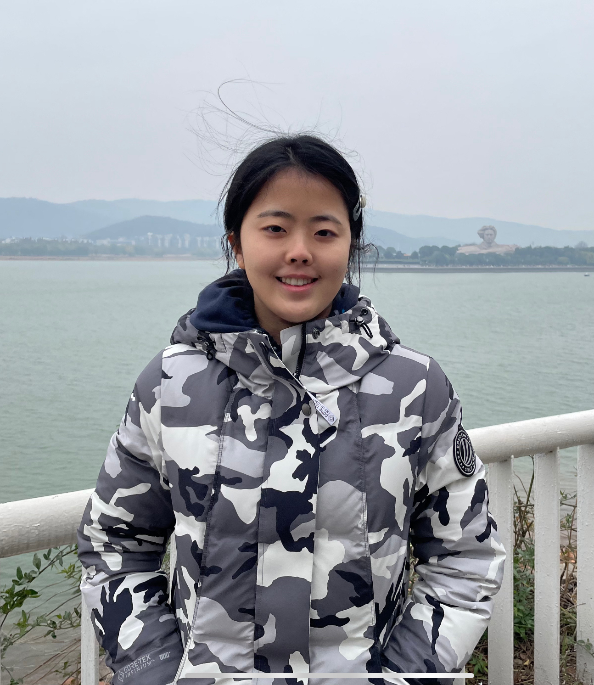

We are a team based in the [School of Computing, National University of Singapore](https://www.comp.nus.edu.sg).

For questions or bug reports, use the [sudoContact issue tracker](https://github.com/AY2627S1-CS2103T-W10-1/tp/issues).

## Project team

### Jack Chua

[[github](https://github.com/jackchuayc)]

* Role: Developer

### Tze Min

[[github](https://github.com/L-TM)]

* Role: Developer

### Jovan Lo

[[github](https://github.com/snowlyr)]

* Role: Developer

### Liu Yuqi

[[github](https://github.com/Liu-Yuqi-617)]

* Role: Developer

### He Qianyi

[[github](https://github.com/He-Qianyi)]

* Role: Developer
* Responsibilities: Partial-contact addition, contact details viewing, CSV export, and related tests and documentation
