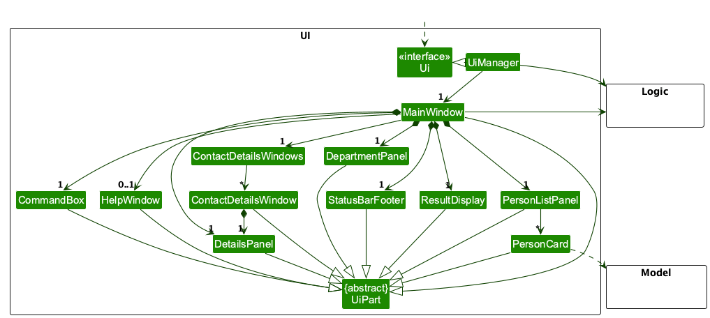
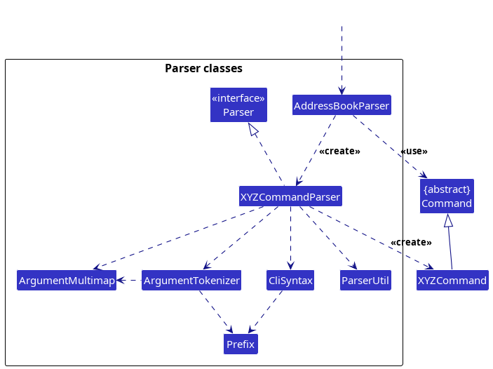
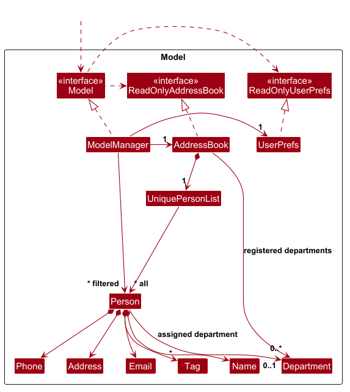
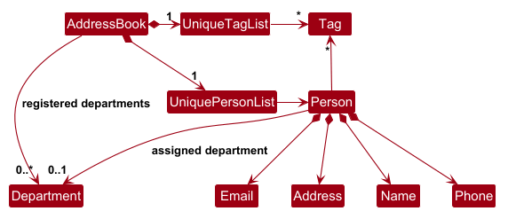
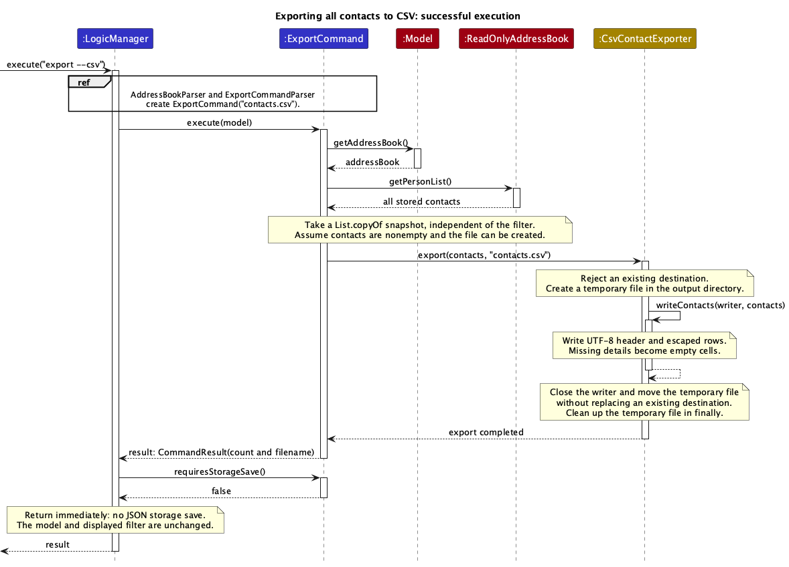
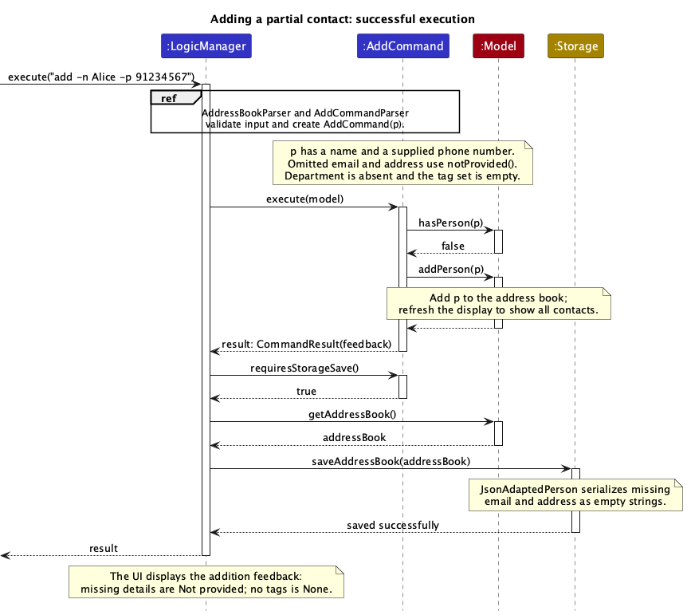
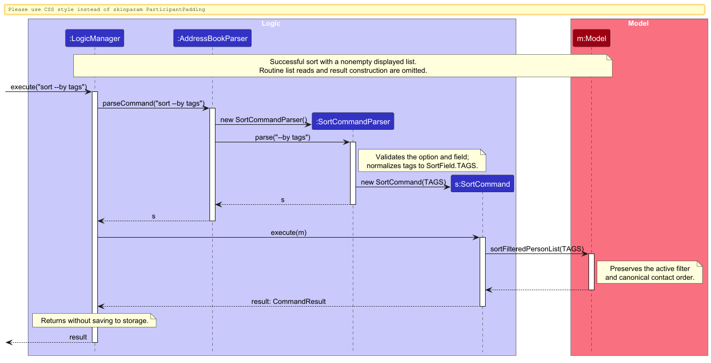
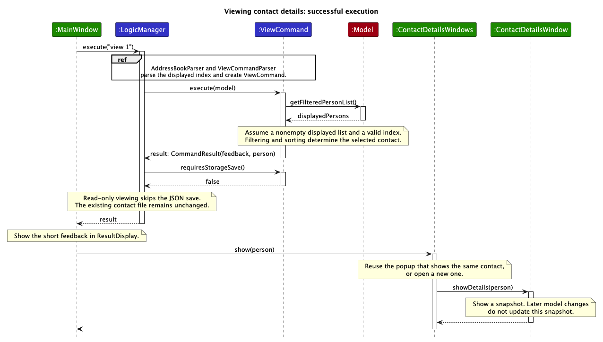
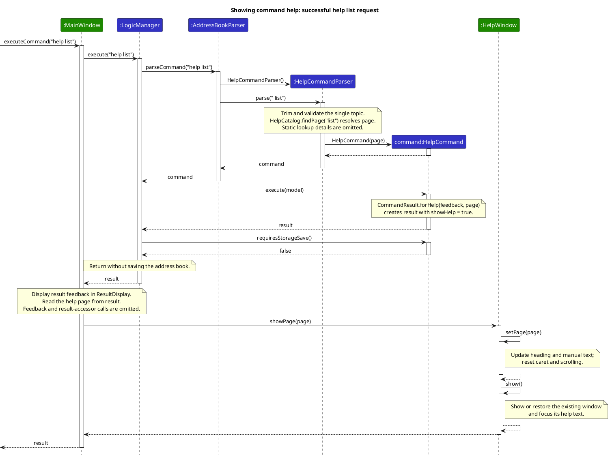

* Table of Contents
{:toc}

--------------------------------------------------------------------------------------------------------------------

## **Acknowledgements**
This project is based on the AddressBook-Level3 project created by the [SE-EDU initiative](https://se-education.org).

* [SE-EDU initiative](https://se-education.org)
* He Qianyi used OpenAI Codex to assist with feature 4 (partial-contact addition): parser/options,
  omitted-field representation, duplicate identity, storage/UI integration, tests and related UG/DG documentation.
* He Qianyi used OpenAI Codex to assist with the feature 3 `view CONTACT_ID` implementation, including the
  command/parser, details window, command-result integration, tests, and related
  User Guide/Developer Guide documentation.

OpenAI Codex assisted He Qianyi with the Feature 11 CSV export implementation, tests and documentation.
He Qianyi is responsible for reviewing and understanding these changes.
He Qianyi used OpenAI Codex to assist with updating and verifying the UI class diagram and the UML sequence diagrams for contact viewing, partial-contact addition and CSV export.

--------------------------------------------------------------------------------------------------------------------

## **Setting up, getting started**

Refer to the guide [_Setting up and getting started_](SettingUp.md).

--------------------------------------------------------------------------------------------------------------------

## **Design**

<div markdown="span" class="alert alert-primary">

:bulb: **Tip:** The `.puml` files used to create diagrams are in `docs/diagrams`. Refer to the [_PlantUML Tutorial_ at se-edu/guides](https://se-education.org/guides/tutorials/plantUml.html) to learn how to create and edit diagrams.
</div>

### Architecture


The ***Architecture Diagram*** given above explains the high-level design of the App.

The following provides a quick overview of the main components and their interactions.

**Main components of the architecture**

**`Main`** (consisting of classes [`Main`](https://github.com/se-edu/addressbook-level3/tree/master/src/main/java/seedu/address/Main.java) and [`MainApp`](https://github.com/se-edu/addressbook-level3/tree/master/src/main/java/seedu/address/MainApp.java)) is in charge of the app launch and shut down.
* At app launch, it initializes the other components in the correct sequence, and connects them up with each other.
* At shut down, it shuts down the other components and invokes cleanup methods where necessary.

The bulk of the app's work is done by the following four components:

* [**`UI`**](#ui-component): The UI of the App.
* [**`Logic`**](#logic-component): The command executor.
* [**`Model`**](#model-component): Holds the data of the App in memory.
* [**`Storage`**](#storage-component): Reads data from, and writes data to, the hard disk.

[**`Commons`**](#common-classes) represents a collection of classes used by multiple other components.

**How the architecture components interact with each other**

The *Sequence Diagram* below shows how the components interact with each other for the scenario where the user issues the command `delete 1`.


Each of the four main components (also shown in the diagram above),

* defines its *API* in an `interface` with the same name as the Component.
* provides its functionality through a concrete `{Component Name}Manager` class that implements the corresponding API interface.

For example, the `Logic` component defines its API in `Logic.java` and implements it in `LogicManager.java`. Other components interact with a component through its interface rather than its concrete class, preventing them from coupling to that component's implementation, as illustrated in the following partial class diagram.


The sections below give more details of each component.

### UI component

The **API** of this component is specified in [`Ui.java`](https://github.com/se-edu/addressbook-level3/tree/master/src/main/java/seedu/address/ui/Ui.java)



The UI consists of a `MainWindow` and its parts, such as `CommandBox`, `ResultDisplay`, `DepartmentPanel`, `PersonListPanel`, `DetailsPanel`, and `StatusBarFooter`. All of these, including `MainWindow`, inherit from the abstract `UiPart` class, which captures common behavior among classes that represent visible GUI parts.

`MainWindow` lays its parts out as numbered panes, in the style of a terminal dashboard: [1] `DepartmentPanel`
(each registered department with its number of contacts), [2] `PersonListPanel` (one table row per contact, which
grows taller when its tags wrap), [3] a docked `DetailsPanel`, and [4] the `ResultDisplay` above the `CommandBox`
prompt. Alt+1 to Alt+4 (or Esc for the prompt) move the keyboard focus between them, and the pane with the focus
is outlined. `DepartmentPanel` and `StatusBarFooter` read the unfiltered `Logic.getPersonList()` and
`Logic.getDepartmentList()`, so they stay up to date with every change.

Contact details appear in two places. The docked [3] pane follows the selection in [2]: selecting a row with a
click or j/k formats that contact with `ViewCommand.formatDetails(Person)` and shows it at once, without running a
command, so glancing through contacts stays instant. To compare contacts side by side, details can also pop out
into windows managed by `ContactDetailsWindows`. A successful `view` command returns the
viewed `Person` and a details snapshot through `CommandResult`. `ContactDetailsWindows.show(Person, String)` refreshes
the open `ContactDetailsWindow` (a `UiPart<Stage>`) whose contact `isSamePerson` as the viewed one, or opens a new
popup cascaded from the main window. An edit can change every field `isSamePerson` compares, so
`ContactDetailsWindows` also listens to `Logic.getPersonList()`: when a contact is replaced in place, its popup
switches to the edited `Person`, and viewing a renamed contact still refreshes its popup. Like the docked pane, each
popup hosts a `DetailsPanel`, which turns every `Field: value` line of the snapshot into a grey field name beside a
read-only value that can be selected with j/k or Tab and copied. Several contacts can therefore be compared side by
side, while viewing the same contact again never duplicates its popup. Popups are owned by the main stage, so they
stay in front of it, and the keyboard focus stays at the prompt after `view`. Pressing Enter on a row in [2], or
double-clicking it, runs `view` with that row's contact ID. Repeated Alt+3 presses step through the docked pane and
then each popup, `q` closes the focused popup, and every popup is hidden when the application exits.

The `UI` component uses the JavaFX UI framework. The layouts of these UI parts are defined in matching `.fxml` files in `src/main/resources/view`. For example, [`MainWindow.fxml`](https://github.com/se-edu/addressbook-level3/tree/master/src/main/resources/view/MainWindow.fxml) specifies the layout of [`MainWindow`](https://github.com/se-edu/addressbook-level3/tree/master/src/main/java/seedu/address/ui/MainWindow.java).

The `UI` component,

* executes user commands using the `Logic` component.
* listens for changes to `Model` data so that the UI can be updated with the modified data.
* keeps a reference to the `Logic` component, because the `UI` relies on the `Logic` to execute commands.
* depends on some classes in the `Model` component because it displays `Person` objects from the model.

### Logic component

**API** : [`Logic.java`](https://github.com/se-edu/addressbook-level3/tree/master/src/main/java/seedu/address/logic/Logic.java)

Here's a (partial) class diagram of the `Logic` component:


The sequence diagram below illustrates the interactions within the `Logic` component, taking `execute("delete 1")` API call as an example.


<div markdown="span" class="alert alert-info">:information_source: **Note:** The lifeline for `DeleteCommandParser` should end at the destroy marker (X), but due to a limitation of PlantUML, it continues to the end of the diagram.
</div>

How the `Logic` component works:

1. When `Logic` is called upon to execute a command, the command is passed to an `AddressBookParser` object, which in turn creates a parser that matches the command (e.g., `DeleteCommandParser`) and uses it to parse the command.
1. This results in a `Command` object (more precisely, an object of one of its subclasses e.g., `DeleteCommand`) which is executed by the `LogicManager`.
1. The command can communicate with the `Model` when it is executed (e.g. to delete a person).<br>
   Note that although this is shown as a single step in the diagram above for simplicity, the code can require several interactions between the command object and the `Model` to complete the operation.
1. `LogicManager` saves the canonical address book if `Command.requiresStorageSave()` returns true. `SortCommand` returns false because ordering is display-only; unconfirmed `ClearCommand` also returns false.
1. The result of the command execution is encapsulated as a `CommandResult` object which is returned from `Logic`.

Here are the other classes in `Logic` (omitted from the class diagram above) that are used for parsing a user command:



How the parsing works:
* When called upon to parse a user command, the `AddressBookParser` class creates an `XYZCommandParser` (`XYZ` is a placeholder for the specific command name, e.g., `AddCommandParser`). The parser uses the other classes shown above to parse the user command and create an `XYZCommand` object (e.g., `AddCommand`). The `AddressBookParser` returns that object as a `Command` object.
* All `XYZCommandParser` classes, such as `AddCommandParser` and `DeleteCommandParser`, implement the `Parser` interface so they can be treated similarly where appropriate, for example during testing.

### Model component
**API** : [`Model.java`](https://github.com/se-edu/addressbook-level3/tree/master/src/main/java/seedu/address/model/Model.java)




The `Model` component,

* stores the address book data i.e., all `Person` objects (which are contained in a `UniquePersonList` object).
* maintains an observable display-order projection separate from the canonical person list. A `FilteredList` over this projection applies the current filter and preserves display-only sorting. It exposes an unmodifiable `ObservableList<Person>` shared by the UI and index-based commands.
* records session-local deletion history alongside the contact data.
* stores a `UserPrefs` object that represents the user’s preferences (currently, just the GUI settings). This is exposed to the outside as a `ReadOnlyUserPrefs` object.
* does not depend on any of the other three components (as the `Model` represents data entities of the domain, they should make sense on their own without depending on other components)

<div markdown="span" class="alert alert-info">:information_source: **Note:** The alternative, arguably more object-oriented, design below keeps a unique list of tags in `AddressBook`, and each `Person` references tags from that list. This lets `AddressBook` maintain one `Tag` object per unique tag instead of each `Person` holding its own `Tag` objects.<br>



</div>


### Storage component

**API** : [`Storage.java`](https://github.com/se-edu/addressbook-level3/tree/master/src/main/java/seedu/address/storage/Storage.java)


The `Storage` component,
* can save both address book data and user preference data in JSON format, and read them back into corresponding objects.
* is implemented by `StorageManager`, which delegates the actual JSON file access to `JsonAddressBookStorage` and `JsonUserPrefsStorage` (one class per data file).
* depends on some classes in the `Model` component (because the `Storage` component's job is to save/retrieve objects that belong to the `Model`)

### Common classes

Classes used by multiple components are in the `seedu.address.commons` package.

--------------------------------------------------------------------------------------------------------------------

## **Implementation**

This section describes some noteworthy details on how certain features are implemented.

### CSV export (Feature 11 / UC9)

The sequence below shows a successful CSV export. Parsing is summarized in a reference frame; the command
reads all stored contacts, writes the CSV through `CsvContactExporter`, and skips the normal JSON save.



`AddressBookParser` dispatches `export` to `ExportCommandParser`. The parser requires `-c` or `--csv`, accepts
one optional basename (with matching quotes for spaces), and defaults to `contacts.csv`.
`CsvContactExporter.isValidFileName` rejects paths, invalid characters and reserved Windows device names
so the command has the same filename policy on all supported platforms. The filename policy follows
[Windows filename restrictions](https://learn.microsoft.com/en-us/windows/win32/fileio/naming-a-file).

`ExportCommand` snapshots `model.getAddressBook().getPersonList()` rather than the filtered list.
It rejects an empty snapshot, then delegates file writing to the storage helper `CsvContactExporter`.
The command leaves the model and filter unchanged. A successful command returns the row count and filename
through the existing feedback display. Its `requiresStorageSave()` override skips the unrelated JSON save:
once the CSV exists, a JSON save failure must not turn a successful export into an error.

The exporter writes UTF-8 with a fixed six-column header and CRLF record separators. Values containing
commas, double quotes, CR or LF are quoted, and inner double quotes are doubled, following
[RFC 4180](https://www.rfc-editor.org/rfc/rfc4180). It writes raw field values, maps an absent department
to an empty cell, sorts tags and joins them with `; `. It preserves input order and repeated records.
Raw empty values also allow partial contacts to be exported when the partial-add feature is integrated.

The exporter writes and closes a temporary file in the destination directory before moving it to the
requested name. It checks for an existing destination and moves without `REPLACE_EXISTING`, so a file
created during export is also protected. The temporary file is cleaned up on completion or failure.
`FileAlreadyExistsException` produces a choose-another-filename message; other `IOException`s produce
a file creation error instead of a success result. The default output directory is the process working
directory; an injectable exporter isolates tests and simulates permission or interrupted-write failures.

Export uses validated in-memory contacts. Invalid JSON/contact data is handled by the existing startup
loader; export does not re-read a JSON file edited externally during the session. It adds no recovery path
for corrupted persistent data. Parser, model integration, real file, cleanup and JavaFX command-box tests
cover the export flow, including a filtered list and an existing destination.

### Adding contacts with partial information

The sequence below shows the successful addition of a partial contact with a name and phone number.
Parsing creates missing-value objects for omitted email and address fields; the command checks for duplicates,
adds the contact, and follows the normal JSON save.



`AddCommandParser` and `EditCommandParser` share `ArgumentTokenizer`. Each `Prefix` in `CliSyntax` has a
short and a long form (e.g. `-n`/`--name`), and both forms map to the same `ArgumentMultimap` key, so they can
be mixed and repeats in either form are detected as duplicates. The tokenizer splits input into words, treats a
quoted word as literal text (never a flag), rejects unknown `--` options, and stores each word after `-t`/`--tag`
as a separate tag. Name and at least one phone number or email address are required. Both the parser and
`AddCommand` reject contacts without either means of contact. Omitted phone, email and address use immutable
`notProvided()` value objects whose
stored values are empty strings and whose display strings are `Not provided`. Their public constructors and
parser validators still reject empty supplied values. Department remains optional. The department
catalogue and assignment rules are specified below under Department management.

`JsonAdaptedPerson` maps null, omitted or empty phone/email/address fields to the missing value objects;
nonempty invalid data still causes a loading error. Existing fully populated data retains its fields.
`add` and `edit` both parse user input through `ParserUtil`, which validates phone numbers as 7–15 digits and
tags as 1–30 characters with the team-specified hyphen/underscore support and leading `#`/`/` normalization.
Keeping these rules in `ParserUtil`, rather than in one command's parser, keeps the two commands consistent.
Storage retains compatibility with previously valid short phone numbers (`Phone.isValidPhone` still accepts
3 or more digits) and longer tags through `Tag.fromStoredValue`; normal tag validation uses the shared 1–30
character limit, including tag searches. This avoids a migration of old contact data.
Tag search and matching reuse the teammate's implementation.

`Person.isSamePerson` requires the same name and at least one matching provided phone number or email
address. Missing fields are not matches. Address, Department and tags do not contribute to identity.
This duplicate relation is not transitive: a proposed edit can match its original contact by phone and another
contact by email. Therefore both `EditCommand` and `UniquePersonList.setPerson` check every other contact,
excluding the edited target, even when the original and edited versions match. `edit` can complete partial
contacts while preserving their other fields. Assigned departments must already exist in the department catalogue.
Editing a legacy contact without phone and email requires supplying at least one of them; storage loading
retains compatibility with old missing fields.

Loading is restoration rather than a new addition. `JsonSerializableAddressBook` validates all supplied
fields and department references, then restores the complete ordered list through `AddressBook.setPersons`.
Bulk restoration rejects only repeated name/phone/email combinations, as the previous storage rule did.
It therefore preserves every previously valid contact, including same-name contacts sharing either phone or
email, instead of rejecting the file and starting with empty data. The same path preserves these records when
`ModelManager` copies the address book and department operations replace contact objects without changing
their identities. Department undo also restores assignments in bulk and updates history references.
`addPerson`, interactive `setPerson` and contact undo continue to enforce `Person.isSamePerson` strictly;
there is no global switch that disables duplicate checks. Existing unresolved conflicts are retained on disk,
and a contact edit must produce an identity that does not conflict with another record. Contact undo also
requires a phone number or email address; attempting to restore a legacy name-only contact leaves both the
file and deletion history unchanged and reports the missing-information error.

`LegacyContactCompatibilityTest` loads previously valid JSON through the real `MainApp` startup path, with
and without a department catalogue. It verifies every contact field and ordering after a saving command,
an unrelated addition and repeated restarts, plus strict add/edit/contact-undo rejection and department
rename/delete/undo on the restored data. Rejected operations retain stored bytes and contact undo history.

`AddCommand` returns full labelled feedback, sorted tags and missing-field placeholders. In the contact
table, `PersonCard` shows a dimmed `—` for missing fields and for no tags, while the [3] Details pane and
popups show the same `Not provided` and `None` placeholders as `AddCommand`. `LogicManager` retains the
existing save failure behaviour: it reports the error instead of returning an addition-success result.

### Department management: design specification

The department catalogue is stored alongside contacts in the address book. `depart` manages a shared
catalogue of department names, while `edit` assigns a catalogue entry to an individual contact.
The catalogue includes departments with no assigned contacts and is independent of the current contact filter.

| Command | Behaviour |
| --- | --- |
| `depart --delete DEPARTMENT` | Remove a catalogue entry and clear matching assignments in contacts and deletion history. |
| `depart --list` | List all departments in the catalogue, including unused departments. Report an empty catalogue when none exist. |
| `depart --add DEPARTMENT` | Add a new department to the catalogue without assigning it to any contact. |
| `depart --edit OLD_DEPARTMENT NEW_DEPARTMENT` | Rename an existing catalogue entry and update every contact assigned to it, including contacts hidden by a filter. |
| `edit CONTACT_ID --department DEPARTMENT` | Assign an existing catalogue department to the contact at the specified displayed-list position. The short option `-d` is also supported. |

Examples: `depart --add Engineering`, `depart --list`, `depart --edit Engineering "Research & Development"`,
and `edit 1 --department "Research & Development"`. Quote names containing spaces to distinguish the two
arguments of `depart --edit`. The command word is `depart` for all four catalogue operations.
The previous `depart CONTACT_ID --set DEPARTMENT` form is replaced by `edit CONTACT_ID --department DEPARTMENT`.

Department names are case-sensitive and must contain 2-50 characters using only letters, numbers, spaces, `-`, or `&`.
All department inputs are trimmed before format validation and catalogue lookup; spaces inside quoted names are preserved, while leading and trailing whitespace is discarded. `Department` stores the trimmed name, including when loading existing catalogue and contact data.
Reject empty or invalid names, duplicate catalogue additions, an unknown rename source, and a rename target
that already belongs to another catalogue entry. Reject missing arguments, extra arguments, and combined
catalogue operations without modifying the catalogue or contacts.

Renaming changes the catalogue entry and all its contact assignments as one logical operation; other contact
fields remain unchanged. Persist the catalogue (including unused entries) and updated assignments across restarts.
Listing departments does not modify contacts, the catalogue, filtering, or sorting.

`edit` validates both the displayed contact ID and membership of the requested name in the catalogue.
An unknown department is rejected without changing any supplied contact fields; the user must first register it
with `depart --add`. Omitting `--department` preserves the contact's existing department. A successful assignment
replaces only that contact's department, along with any other explicitly supplied edit fields; it does not rename
a catalogue entry or affect other contacts. Contacts may still have no department.
`add --department` applies the same catalogue membership check before adding a contact.

`AddressBook` owns the observable department catalogue and exposes an unmodifiable view through
`ReadOnlyAddressBook.getDepartmentList()`. In the Model class diagram, `AddressBook` is associated with
zero or more registered `Department` values, while each `Person` has zero or one assigned department.
Department equality is based on the case-sensitive name; assignments do not require the same object instance
as the catalogue entry.

`AddressBookParser` routes `depart` to `DepartCommandParser`. The parser uses the shared quote-aware word
lexer to enforce one operation and its exact argument count, validates names with `Department`, and creates
`DepartCommand.list()`, `DepartCommand.add(...)`, `DepartCommand.delete(...)`, or `DepartCommand.rename(...)`.
`DepartCommand.execute` checks catalogue membership through `Model.hasDepartment` before a mutation.
Additions delegate to `ModelManager.addDepartment`; renames delegate to `ModelManager.renameDepartment`.
`AddressBook.renameDepartment` replaces matching contacts with copies produced by
`Person.withRenamedDepartment`, preserving their other fields and leaving unrelated contacts unchanged.

`depart --list` skips the storage save and preserves display state. Adding an unused catalogue entry also
preserves contact filtering and sorting. `EditCommandParser` stores `-d`/`--department` in
`EditPersonDescriptor`; `EditCommand` checks the displayed index and catalogue membership before updating
any fields. A successful contact edit displays all contacts in stored order.
`ModelManager.renameDepartment` updates both stored contacts and deletion history, so `undo` cannot restore
an obsolete department name. A rename retains the active filter and resets display sorting.
`DepartCommand.delete(...)` validates catalogue membership before calling `ModelManager.deleteDepartment`.
`AddressBook.deleteDepartment` removes the entry and clears matching assignments, including hidden contacts.
`ModelManager` records the department and affected contact objects in a deletion entry, alongside markers for
contact deletions in a shared chronological history. Matching assignments in contact deletion history are
cleared too. The active filter is retained and sorting resets to stored order.
`UndoCommand` checks the latest deletion type. For a department deletion, it rejects an existing catalogue name
before changing state; otherwise it restores the department and assignments on tracked contacts still without
a department, including contacts awaiting restoration. `setPerson` updates tracked references so subsequent
name or phone edits survive undo. Explicit reassignment to another department is preserved. Missing contacts
are not recreated. The history entry is consumed only on success, and all contacts are displayed in stored order.
Department restoration reports `Restored deleted department: [NAME]`; a name conflict reports
`Cannot restore the deleted department because it already exists: [NAME]` and preserves data and history.
History is session-only. Successful deletion and restoration use the normal storage-save flow.

Renaming an entry to its own name is allowed. `clear` resets the catalogue together with contacts.

`JsonSerializableAddressBook` persists names in a `departments` array, including unused entries.
Legacy files with an absent or null `departments` array derive the catalogue from their contact assignments. Files containing an explicit
catalogue reject exact duplicate or invalid names and contact assignments absent from the catalogue.
Legacy catalogue entries differing only in surrounding whitespace are merged in first-occurrence order;
contact assignments are normalized to the same names. Normalized data is persisted on the next successful save.
`LogicManager` saves successful catalogue additions, renames, deletions, and contact assignments through the normal
storage flow. A save failure is reported instead of success; the in-memory change is not rolled back.
`DepartmentIntegrationTest` covers persistence, rejected edits, listing without writes, and rename followed by undo.
`DepartCommandParserTest`, `DepartCommandTest`, `AddressBookTest`, and `JsonSerializableAddressBookTest`
cover invalid input, catalogue constraints, unaffected contacts, and legacy-data loading.

#### Department command formats and feedback

| Operation | Format | Required name arguments |
| --- | --- | --- |
| List | `depart --list` | None |
| Add | `depart --add DEPARTMENT` | Exactly one |
| Delete | `depart --delete DEPARTMENT` | Exactly one |
| Rename | `depart --edit OLD_NAME NEW_NAME` | Exactly two, source first |

The command word `depart` is case-insensitive. Options are lowercase, case-sensitive, unquoted,
and have no short forms. Choose exactly one operation; extra arguments and repeated or combined operations
are rejected. Use ordinary ASCII hyphens and separate the option and arguments with whitespace.
The old `depart CONTACT_ID --set DEPARTMENT` form is not supported.

Names are case-sensitive and contain 2-50 characters from ASCII letters (`A-Z`, `a-z`), digits (`0-9`),
spaces, `-`, and `&`; names consisting only of whitespace are invalid. Names containing spaces must be one quoted argument, using matching single or double quotes, e.g. `depart --edit Engineering "Customer Support"`.
Unlike `add` and `edit`, an unquoted multi-word department name is treated as multiple arguments and is rejected.
A closing quote must be followed by whitespace or the end of input. An unquoted name starting with `--`
is treated as an invalid option-like argument. To use such a name, quote it.
Renaming to the source's exact current name is allowed; renaming to another existing entry is not.

**Validation order:** Command structure (including quotes, option and argument count) is checked first.
Names are then validated left to right, checking blank values before character and length constraints.
Only after all names are valid does the system check whether a deletion target exists, an addition is a duplicate,
or, for a rename,
whether the source exists followed by whether the target belongs to another entry. The first failure is reported;
no catalogue or contact changes occur on validation failure. For example, `depart --edit Unknown !`
reports the invalid target name before checking whether Unknown exists.

In the messages below, bracketed placeholders are replaced by the supplied names without surrounding quote
characters. Code blocks show actual line breaks.

| Condition | Feedback |
| --- | --- |
| List a nonempty catalogue | `Departments:` followed by each registered name on a separate line. |
| Add a department | `Added department: [NAME]` |
| Rename a department | `Renamed department: [OLD_NAME] -> [NEW_NAME]` |
| Invalid command structure, including a missing name argument | The format error shown below. |
| Supplied name is empty or whitespace-only, e.g. `depart --add ""` | `Department name cannot be empty.` |
| Nonblank name violates character or length constraints | `Invalid Department: Must be 2-50 characters using only letters, numbers, spaces, '-', or '&'.` |
| Addition duplicates an existing entry | `Department already exists: [NAME]` |
| Delete target does not exist | `Department does not exist: [NAME]. Use depart --list or depart --add DEPARTMENT.` |
| Delete a department | `Deleted department: [NAME]. Associated contacts now have no department.` |
| Rename source does not exist | `Department does not exist: [OLD_NAME]. Use depart --list or depart --add DEPARTMENT.` |
| Rename target belongs to another entry | `Department already exists: [NEW_NAME]` |
| Catalogue is empty | `No departments have been registered.` |

Invalid command structure includes missing, unknown or quoted operations; missing or extra arguments;
repeated or combined operations; unmatched quotes or text immediately following a closing quote; and
unquoted names beginning with `--`. The exact feedback is:

```text
Invalid command format!
depart --list | depart --add DEPARTMENT | depart --edit OLD_NAME NEW_NAME | depart --delete DEPARTMENT
```

### Searching contacts by tags (UC6)

The tag-search command is `find --tag TAG [--tag TAG ...]`. Each tag requires its own lowercase `--tag`
option; the command word is case-insensitive. Tags are case-sensitive and contain 1-30 ASCII letters,
digits, hyphens, or underscores. Surrounding whitespace is ignored, but internal whitespace is invalid.
Unlike contact-input parsing, tag search does not remove quotes or leading `#` or `/` characters:
`find --tag "client"` and `find --tag #client` are invalid; use `find --tag client`.

#### Parsing and validation

`AddressBookParser` delegates `find` to `FindCommandParser`. The parser recognizes standalone `--tag`
tokens and treats the trimmed text between consecutive options as one tag value. It rejects text before
the first `--tag`, preventing a combined name-and-tag search. It validates values from left to right using
`Tag.isValidTagName`, reporting the first failure before constructing a command.

| Condition | Feedback |
| --- | --- |
| Missing or whitespace-only value after `--tag` | `Tag cannot be empty: Please provide a valid tag after '--tag'.` |
| Nonempty tag violates character or length constraints | `Invalid Tag: '[INPUT]' must be 1-30 characters using only letters, numbers, hyphens (-), and underscores (_), with no spaces.` |
| No standalone `--tag`, but an option-like token is supplied | `Invalid find option: '[INPUT]'. Use find --tag TAG [--tag TAG ...] or find KEYWORD [MORE_KEYWORDS].` |
| No arguments, or text before the first standalone `--tag` | `Invalid command format!` followed by a newline and `FindCommand.MESSAGE_USAGE`. |

`[INPUT]` is the failing trimmed tag value or option token. Without a standalone `--tag`, a token beginning
with `-`, an en dash, or an em dash is treated as an unsupported option; otherwise parsing follows the
existing name-search path. After a valid `--tag`, unsupported option text is part of the value:
`find --tag client --unknown` fails tag validation because the value contains a space.
`find --tag --unknown` is a valid query for the literal tag `--unknown`, since hyphens are allowed.
Quoted empty text is not a missing value: `find --tag ""` produces the invalid-tag message.
Parsing failures leave the current filter, display order, and contacts unchanged.

#### Matching and execution

For valid tag input, the parser constructs `FindCommand(new TagsMatchPredicate(tags))`.
`TagsMatchPredicate` keeps an immutable copy of the query and uses `String.equals` to compare complete
stored tag names. A contact matches if any stored tag equals any requested tag (OR matching); substring
matches and case-only differences do not match. Contacts with no tags do not match.

`FindCommand.execute` passes the predicate to `Model.updateFilteredPersonList`. `ModelManager` restores
the display projection to stored order and applies the new predicate across all stored contacts, replacing
any previous filter and resetting sorting. Filtering selects entries from the stored contact list, so repeated
query tags or multiple matching tags do not duplicate contacts in the results.

A successful search reports `[COUNT] person(s) listed!`. If no contacts match, it displays an empty list and
`No contacts found with the specified tag(s).`; this is a valid search result, not a validation error.
Contact fields remain unchanged. `FindCommand` retains the normal `LogicManager` storage-save flow;
a save failure is reported after the display filter has been updated.

`FindCommandParserTest` covers repeated options, whitespace, tag length boundaries, invalid tags,
unsupported options, and mixed name/tag input. `TagsMatchPredicateTest` verifies OR matching, exact case,
whole-tag matching, and defensive copying. `FindCommandTest` verifies filtered results and feedback.

### Listing all contacts: design specification

The list feature lets users review every stored contact after applying a search or filter.
It accepts `list` or `ls`, with no parameters. Command words are case-insensitive;
`LIST`, `List`, and `LS` are accepted. Leading and trailing spaces are ignored.
Both spellings clear the current filter and display sorting, showing contacts in stored order.

Any extra input produces exactly:
`The list command does not accept any parameters. Usage: list | ls`
Rejecting extra input prevents users from assuming unsupported filtering or sorting options were applied.

`AddressBookParser` routes both spellings to `ListCommandParser`, which rejects nonblank arguments
before creating the shared `ListCommand`. Its execution uses `PREDICATE_SHOW_ALL_PERSONS` through
`Model.updateFilteredPersonList` to restore the full contact list and stored order.

### Contact display sorting

The sequence diagram below shows a successful `sort --by tags` command with a nonempty displayed list.
It focuses on parsing and execution within Logic, treating Model as a black box.



`LogicManager` passes the command text to `AddressBookParser`, which delegates the arguments to
`SortCommandParser`. The parser validates the option and field, normalizes `tags` to `SortField.TAGS`, and
creates a `SortCommand`. `LogicManager` then executes the command, which calls `Model.sortFilteredPersonList`
to reorder the displayed contacts while preserving the active filter and canonical contact order.
The command returns a `CommandResult` with the displayed contact count and selected field.

The diagram's final note summarizes the storage behavior: `SortCommand.requiresStorageSave()` returns false,
so `LogicManager` returns the result without saving. Routine list reads, result construction, and this storage
check are omitted from the diagram for clarity. Existing commands retain their previous save behavior.
Parse-error precedence is descending option, unsupported argument structure, missing option/value, then invalid
field; the user guide lists the exact messages.

`ModelManager` maintains an observable display projection separate from `AddressBook`. `FilteredList` is backed by
this projection, so the UI and index-based commands share the same displayed order. Sorting only rearranges visible
positions and preserves the filter. Successful canonical contact changes refresh the projection and reset sorting;
`list` and `find` also reset sorting through `updateFilteredPersonList`. `view` and `help` preserve the order.
Undo appends the restored contact in canonical order and shows the full list, preserving its department and tags.
The address book listener keeps direct changes through the existing read-only list's observable backing synchronized.

`ContactSorter` precomputes keys, then stably sorts a copy using case-insensitive comparison and missing values last.
It keeps duplicate occurrences and never mutates input. Stability uses the current display order, including when
switching fields. No contact-name tie-breaker is applied. Sorting a canonical-source `SortedList` without preserving current tie order would violate this rule.

`SortField.DEPARTMENT` reads the optional stored value from `Person.getDepartment()`. Department and tag
constructors validate their immutable values; sorting rejects null tag elements before changing the display.
Missing departments sort last.
Tag keys use the case-insensitive minimum of the unordered tag set; empty tag sets are absent keys.
Tag sorting does not group a contact by all of its tags, and does not change the stored tag set.
`ContactSorterTest` verifies real department values, case-insensitive ordering, missing values, and stable ties.
`view`, `edit`, and `delete` resolve indices against the same sorted display; undo preserves department data.

`MainApp` logs startup loading failures and initializes an empty address book when loading fails.
Sorting uses the current in-memory contacts, so valid contacts added afterward can be sorted without restarting.
An empty displayed list produces `No contacts found to sort.` Sorting still rejects null tag elements before
publishing a new order. A missing data file retains the existing sample-data behavior.

Regression coverage includes parser boundaries, aliases and errors; stable department and tag ordering; observable
display/filter behavior; editing and deleting sorted indices; unchanged storage; and recovery after startup loading
failures, including sorting contacts after successful additions and saves in the same session.
Run `./gradlew check coverage` (Windows: `.\gradlew.bat check coverage`) with Java 25.

### Clearing contacts with confirmation

`AddressBookParser` delegates `clear` to `ClearCommandParser`. After trimming surrounding whitespace,
the parser accepts only blank arguments or the exact `--confirm` flag. All other arguments produce
`MESSAGE_INVALID_COMMAND_FORMAT` with `ClearCommand.MESSAGE_USAGE` before any command executes.

`ClearCommand` stores an immutable confirmation flag. Without confirmation, it counts the canonical
address book's contacts and returns a warning; contacts, display filtering and sorting, and deletion
history remain unchanged. Its `requiresStorageSave()` override returns false in this case.
With confirmation, it resets the address book and allows `LogicManager` to save the empty book.
Clearing does not add contacts to individual-deletion history, so it cannot be undone.
Earlier individual deletions remain available to `undo`.

Regression tests cover strict parsing, warning counts with hidden contacts, unchanged display and undo
history, skipped saves for unconfirmed or invalid input, and reloading the empty saved address book
after confirmed deletion.

### Viewing contact details

The sequence below shows a successful `view 1` request for a nonempty displayed list. It resolves the
displayed index and completes the normal JSON save before returning the snapshot to the contact's details popup.



`AddressBookParser` routes `view CONTACT_ID` to `ViewCommandParser`, which validates the contact ID using
`ParserUtil.parseIndex`. `ViewCommand` resolves that contact ID against `Model.getFilteredPersonList()` so that
filtering and sorting determine the selected row. `CONTACT_ID` is the same one-based displayed-list
position used by `edit`, represented internally by `Index`. It reports an empty list or the valid contact ID range
before accessing the contact.

The command formats all currently supported fields as labelled, untruncated lines, sorts tags for stable output,
and returns a `CommandResult` with separate short feedback, the viewed `Person`, and an optional `contactDetails`
payload. `MainWindow` displays only the short feedback in the main result box and forwards the person and payload to
`ContactDetailsWindows`, which shows them in that contact's owner-linked `ContactDetailsWindow` popup containing a
read-only, wrapping, scrollable text area. Each successful `view` updates the contact's popup with a snapshot, or
opens a popup if the contact has none; later model changes do not silently change a displayed snapshot.

`view` follows the existing `LogicManager` save flow, like `list` and `find`, while preserving contact data
and the current filter. Standard save errors are reported before a new details result reaches the UI. Contacts
are validated and loaded into the model at startup, so `view` does not re-read contact data from disk.

Department display reads `Person.getDepartment()` from the Department implementation tracked by issue #65.
The optional value is shown in full, or as `Department: Not provided` when absent. The `view` command uses
the same displayed-list position as `edit`, so setting a department and then viewing that contact remains
consistent after filtering.

### Showing command help

The sequence below shows a successful `help list` request, from command parsing to displaying the
`list` manual in the reusable help window.



`AddressBookParser` creates a `HelpCommandParser`, which validates the optional topic and resolves its
`HelpPage` through `HelpCatalog.findPage`. For this request, the topic is `list`. The parser creates a
`HelpCommand` carrying that page. The diagram omits the static catalogue lookup and result-factory calls,
and summarizes their effects in notes.

`HelpCommand.execute(model)` returns a `CommandResult` containing the selected page, feedback and
`showHelp = true`. It does not change the model. Its `requiresStorageSave()` method returns false, so
`LogicManager` returns the result without saving the address book. `MainWindow` displays the feedback
and forwards the page to the existing `HelpWindow`. The window updates its heading and text, resets
scrolling, and shows or restores itself with focus on the help text.

With no topic, `help` or `?` selects the overview instead. Topic lookup is case-insensitive and accepts
aliases such as `ls`; unknown topics or multiple arguments produce a `ParseException` before command
execution. The Help menu and F1 call `MainWindow.handleHelp()` directly to display the overview,
bypassing command parsing. These alternative paths are omitted from the successful sequence above.

### Undoing a deletion

`undo` restores the most recent contact deletion in the current session. Contact deletions are created by
`delete INDEX` and are restored in reverse order. `undo` does not revert `add`, `edit`,
`depart --add`, `depart --edit`, or `clear`, and there is no `redo`.

`ModelManager` keeps a shared deletion history containing deleted contacts and deleted departments. The history
is held in memory only. It is not written to the data file, so it is empty every time the app starts. `Model` exposes it through these
operations:

* `Model#deletePerson(Person)` — Removes a contact and records the deletion.
* `Model#hasDeletedPerson()` / `Model#getLastDeletedPerson()` — Inspect the most recent contact deletion when applicable.
* `Model#getLastDeletedDepartment()` — Inspects the most recent department deletion when applicable.
* `Model#restoreLastDeletedPerson()` / `Model#restoreLastDeletedDepartment()` — Restore the corresponding deletion and consume its history entry.

`DeleteCommand` records contact deletions, while the department deletion operation records department deletions.
Both are handled by the shared history used by `UndoCommand`. Delete success feedback ends with
`Use 'undo' to restore.`

Given below is an example usage scenario.

Step 1. The user executes `delete 1`. The deleted contact is recorded in the shared history.

Step 2. The user executes `depart --delete Engineering`. The deleted department and its affected assignments
are recorded after the contact deletion.

Step 3. The user executes `undo`, which restores the deleted department first because it is the most recent
deletion. A second `undo` restores the deleted contact. A third `undo` fails with
`There are no deletions to undo in this session.`

The following sequence diagram shows how `undo` goes through the `Logic` and `Model` components:


<div markdown="span" class="alert alert-info">:information_source: **Note:** The lifeline for `UndoCommandParser` should end at the destroy marker (X), but due to a limitation of PlantUML, it continues to the end of the diagram.
</div>

How `undo` works:

1. `AddressBookParser` passes the input to `UndoCommandParser`, which rejects arguments.
2. `UndoCommand#execute` checks the most recent entry in the shared deletion history.
3. For a department deletion, it checks that the department name is not already registered, restores the
   department and eligible assignments, and consumes the history entry only after success.
4. For a contact deletion, it checks the contact-information and duplicate constraints, restores the contact,
   and consumes the history entry only after success.
5. `LogicManager` saves the address book after a successful restoration. A failed restoration leaves the
   data and deletion history unchanged.

#### Design considerations:

**Aspect: What `undo` records:**

* **Alternative 1 (current choice):** Store contact and department deletions in one shared history.
  * Pros: Uses little memory and preserves the chronological order across `delete INDEX` and
    `depart --delete DEPARTMENT`. `undo` restores the most recent deletion without reverting unrelated commands.
  * Cons: Only contact and department deletions can be undone. Each additional undoable command needs its own
    deletion record and restoration logic.

* **Alternative 2:** A copy of the entire address book after every command that changes it, as in AB3's proposed
  `VersionedAddressBook`.
  * Pros: Any command can be undone, and `redo` is straightforward to add.
  * Cons: Uses more memory. `undo` reverts the most recent change, which may be an `add` or `edit` rather than the
    deletion the user wants back.

**Aspect: Where the deletion history is kept:**

* **Alternative 1 (current choice):** In `ModelManager`.
  * Pros: Each `Model` has its own history, so tests do not share state. `ModelManager#equals` compares the history,
    so `CommandTestUtil.assertCommandSuccess` checks it too.
  * Cons: `Model` exposes separate operations for inspecting and restoring contact and department deletions,
    which every `Model` stub in the tests must implement.

* **Alternative 2:** In a static field of `DeleteCommand` or `UndoCommand`.
  * Pros: `Model` does not change.
  * Cons: A new command object is created for every input, so the history would have to be static. It would then be
    shared by every `Model`, including those in different tests.

### \[Proposed\] Data archiving

_{Explain here how the data archiving feature will be implemented}_


--------------------------------------------------------------------------------------------------------------------

## **Documentation, logging, testing, dev-ops**

* [Documentation guide](Documentation.md)
* [Testing guide](Testing.md)
* [Logging guide](Logging.md)
* [DevOps guide](DevOps.md)

--------------------------------------------------------------------------------------------------------------------

## **Appendix: Requirements**

### Product scope

**Target user profile**:

* is a secretary of a department head at a tech firm
* needs to be able to store contact information offline
* has a need to manage a significant number of contacts
* prefers desktop apps over other types of applications
* can type fast
* prefers typing to mouse interactions
* is reasonably comfortable using CLI apps

**Value proposition**: sudoContact is a lightweight address book that strips away clunky GUIs. It allows you to search, update and route VIP contact data instantly using standard Unix syntax. SudoContact can instantly pipe a filtered list of investors directly into a csv for quick sharing.


### User stories

Priorities: High (must have) - `* * *`, Medium (nice to have) - `* *`, Low (unlikely to have) - `*`

| Priority | As a …​                                    | I want to …​                                  | So that I can…​                                                               |
| -------- |-------------------------------------------|----------------------------------------------|------------------------------------------------------------------------------|
| `* * *`  | new user / forgetful user                 | see usage instructions                       | refer to instructions when I do not know/forget how to use the App           |
| `* * *`  | forgetful user                            | see usage instructions                       | refer to instructions when I do not know/forget how to use the App           |
| `* * *`  | user                                      | add a new person                             |                                                                              |
| `* * *`  | user                                      | delete a person                              | remove entries that I no longer need                                         |
| `* * *`  | user                                      | find a person by name                        | locate details of persons without having to go through the entire list       |
| `* * *`  | user                                      | record which department a contact belongs to | categorise employees for easier filtering                                    |
| `* * *`  | user                                      | search across all tags                       | find someone when I only remember where they work/fragmented info            |
| `* * *`  | user                                      | view one contact's full details              | see all the fields of a person that may be cut off in the list view          |
| `* * *`  | user                                      | add a contact with only partial information  | capture an person's incomplete information if I do not have all their info   |
| `* * *`  | user                                      | undo a delete                                | recover from a mistaken delete                                               |
| `* * *`  | user with many contacts                   | List all contacts                            | quickly review the contacts I have stored                                    |
| `* * *`  | user with many contacts                   | sort contacts by department/tags             | quickly review contact list of people with the same tag                      |
| `* * *`  | user                                      | use unix syntax                              | type faster coming from a unix background                                    |
| `* *`  | user                                      | generate a .csv of the contact list          | Easily copy and paste their email address to quickly send out an email blast |
| `* *`    | user                                      | hide private contact details                 | minimize chance of someone else seeing them by accident                      |
| `*`      | user with many persons in the address book | sort persons by name                         | locate a person easily                                                       |

*{More to be added}*

### Use cases

(For all use cases below, the **System** is `sudoContact` and the **Actor** is the `user`, unless specified otherwise)

**Use Case: UC1 - List all contacts**

**MSS**

1. User requests to list all contacts
2. sudoContact shows a list of contacts

   use case ends

**Extensions**

* 2a. The list is empty.

  * 2a1. sudoContact shows a message indicating that there are no contacts.

  Use case ends.

**Use Case: UC2 - User sorts contacts by department/tag**

**MSS**

1. User displays contacts, either by <u>listing all contacts (UC1)</u> or filtering the list.
2. User requests ascending sorting using `sort -b FIELD` or `sort --by FIELD`.
3. sudoContact validates the option and field, then sorts only the currently displayed contacts.
4. sudoContact shows the sorted list and numbered feedback. The active filter, contact data, and saved order are unchanged.

   Use case ends.

**Extensions**

* 2a. The option or field is missing, invalid, repeated, or accompanied by unsupported arguments.
  * 2a1. sudoContact reports the corresponding parsing error; the current display order is unchanged.
  * Use case ends.
* 2b. The request contains an explicit `--descending` token.
  * 2b1. sudoContact reports that only ascending sorting is supported.
  * Use case ends.
* 3a. The displayed list is empty and startup contact loading succeeded.
  * 3a1. sudoContact displays `No contacts found to sort.`
  * Use case ends.
* 3b. Contact loading failed at startup, or a displayed contact contains invalid department or tag data.
  * 3b1. sudoContact reports the loading or invalid-data error without changing display order or writing the file.
  * Use case ends.

**Use case: UC3 - Delete a contact**

**MSS**

1. User <u>lists all contacts (UC1)</u>.
2. User requests to delete a contact using its index in the currently
   displayed list.
3. sudoContact deletes the selected contact.
4. sudoContact displays the deleted contact's details and informs the
   user that the deletion can be undone.

   Use case ends.

**Extensions**

* 1a. User filters the contacts or <u>sorts contacts by
  department/tag (UC2)</u>.

  Use case resumes at step 2 using the resulting displayed list.

* 1b. The displayed list is empty.

  Use case ends.

* 2a. The deletion request has an invalid format or the index is
  missing, invalid, or outside the displayed list's range.

  * 2a1. sudoContact shows an error message and indicates the
    required format or valid index range.

  Use case resumes at step 2.

**Use case: UC4 - Undo a delete**

**MSS**

1. User requests to undo a deletion.
2. sudoContact restores the most recently deleted contact that has
   not yet been restored in the current session, including its details.
3. sudoContact displays the restored contact's details.

   Use case ends.

**Extensions**

* 1a. The undo request includes additional arguments.

  * 1a1. sudoContact shows an error message explaining that undo
    does not accept arguments.

  Use case resumes at step 1.

* 1b. There are no deletions available to undo in the current session.

  * 1b1. sudoContact informs the user that there are no deletions
    left to undo.

  Use case ends.

* 2a. A duplicate contact already exists.

  * 2a1. sudoContact rejects the restoration and identifies the
    existing contact that prevents it.
  * 2a2. sudoContact retains the deleted contact for a later
    undo attempt.

  Use case ends.


**Use case: UC5a - List departments**

**MSS**

1. User enters `depart --list`.
2. sudoContact validates the command format.
3. sudoContact displays every registered department, including unused departments.

   Use case ends.

**Extensions**

* 3a. The catalogue is empty.

  * 3a1. sudoContact informs the user that no departments have been registered.

  Use case ends.


**Use case: UC5b - Add a department**

**MSS**

1. User enters `depart --add DEPARTMENT`.
2. sudoContact validates the name and checks that it is not already registered.
3. sudoContact adds the department, saves the data and confirms the addition.

   Use case ends.

**Extensions**

* 2a. The command format or department name is invalid.

  * 2a1. sudoContact displays an error and does not modify the catalogue.

  Use case ends.

* 2b. The department already exists.

  * 2b1. sudoContact informs the user that it is already registered.

  Use case ends.


**Use case: UC5c - Rename a department**

**MSS**

1. User enters `depart --edit OLD_NAME NEW_NAME`.
2. sudoContact validates both names and checks the source and target catalogue entries.
3. sudoContact renames the department and updates all associated contacts, including hidden contacts.
4. sudoContact saves the data and confirms the rename.

   Use case ends.

**Extensions**

* 2a. The command format or either name is invalid.

  * 2a1. sudoContact displays an error and does not modify the catalogue or contacts.

  Use case ends.

* 2b. The source does not exist or the target is already registered.

  * 2b1. sudoContact displays the corresponding error and leaves the data unchanged.

  Use case ends.


**Use case: UC5d - Delete a department**

**MSS**

1. User enters `depart --delete DEPARTMENT`.
2. sudoContact validates the name and checks that the department exists.
3. sudoContact removes the department and clears its assignments from current contacts and deletion history.
4. sudoContact records the deletion for `undo`, saves the data and confirms the deletion.

   Use case ends.

**Extensions**

* 2a. The command format, name or existence check fails.

  * 2a1. sudoContact displays an error and leaves the catalogue, contacts and deletion history unchanged.

  Use case ends.


**Use case: UC5e - Assign a department to a contact**

**MSS**

1. User enters `edit CONTACT_ID --department DEPARTMENT`.
2. sudoContact validates the displayed contact ID and checks that the department is registered.
3. sudoContact updates the selected contact, saves the data and confirms the edit.

   Use case ends.

**Extensions**

* 2a. The contact ID, department name or membership is invalid.

  * 2a1. sudoContact displays an error and leaves the contact unchanged.

  Use case ends.


**Use case:** UC6 - Search contacts by tags

**MSS:**

1.  User requests to search for contacts with one or more tags.
2.  User enters a `find` command with one or more `--tag TAG` pairs.
3.  sudoContact validates all specified tags.
4.  sudoContact searches all contacts for those having any of the specified tags (OR matching),
    using case-sensitive, whole-tag matching.
5.  sudoContact displays each matching contact once.
6.  sudoContact displays the number of matching contacts.

    Use case ends.

**Extensions:**

* 3a. A specified tag contains invalid characters, internal spaces, or more than 30 characters.

    * 3a1. sudoContact displays `Invalid Tag: '[INPUT]' must be 1-30 characters using only letters, numbers, hyphens (-), and underscores (_), with no spaces.`

      Use case ends.

* 3b. A tag value is missing.

    * 3b1. sudoContact displays `Tag cannot be empty: Please provide a valid tag after '--tag'.`

      Use case ends.

* 3c. No valid `--tag` option is present and an option-like argument is supplied
  (e.g. `find --tags friends`, `find --TAG friends`, or `find -tag friends`).

    * 3c1. sudoContact displays `Invalid find option: '[INPUT]'. Use find --tag TAG [--tag TAG ...] or find KEYWORD [MORE_KEYWORDS].`

      Use case ends.

* 3d. Arguments precede the first valid `--tag` option (e.g. `find Alice --tag friends`),
  or the `find` command has no arguments.

    * 3d1. sudoContact displays an invalid command format error and the `find` usage instructions.

      Use case ends.

* 4a. No contacts match the specified tag(s).

    * 4a1. sudoContact displays `No contacts found with the specified tag(s).`

      Use case ends.

* 4b. Multiple tags are specified and a contact matches more than one of them,
  or the same tag is specified more than once.

    * 4b1. sudoContact displays the matching contact only once.

      Use case resumes at step 5.


**Use case: UC7 - View one contact's full details**

**MSS**

1. User displays a list of contacts (UC1), which may be filtered or sorted.
2. User enters `view CONTACT_ID`, using the contact ID (one-based row number) in the currently displayed list.
3. sudoContact identifies the contact using that contact ID.
4. sudoContact displays all available details of that contact, including
   fields not shown in the list.

   Use case ends.

**Extensions**

* 1a. The displayed list is empty.

  * 1a1. sudoContact informs the user that there is no contact to view.

  Use case ends.

* 2a. The command format or contact ID is invalid, or the contact ID is outside
  the currently displayed list.

  * 2a1. sudoContact displays an error and indicates the required format
    or valid contact ID range.

  Use case resumes at step 2.

* 3a. The selected contact's stored data cannot be read.

  * 3a1. sudoContact reports that the contact details cannot be displayed.

  Use case ends.

**Use case: UC8 - Add a contact with partial information**

**MSS**

1. User enters `add --name NAME` with at least a phone number or email address,
   including any other information they know, such as department or tags.
2. sudoContact validates the supplied information and checks for a contact
   with the same name and a matching provided phone number or email address. A matching name
   alone does not prevent the contact from being added; omitted fields do not match.
3. sudoContact saves the new contact with the supplied information, leaving
   omitted optional fields unprovided.
4. sudoContact confirms that the contact was added and shows omitted fields
   as `Not provided` or, for tags, `None`.

   Use case ends.

**Extensions**

* 2a. The name is missing or empty, or both phone and email are omitted.

  * 2a1. sudoContact displays an error and does not add the contact.

  Use case resumes at step 1.

* 2b. A supplied field is invalid, an option is unknown, or the command
  format is invalid.

  * 2b1. sudoContact displays an error and does not add the contact.

  Use case resumes at step 1.

* 2c. A duplicate contact already exists.

  * 2c1. sudoContact informs the user that the contact is a duplicate
    and does not add it.

  Use case ends.

* 3a. sudoContact cannot save the new contact.

  * 3a1. sudoContact reports the failure without confirming that the
    contact was added.

  Use case ends.

**Use case: UC9 - Export contacts to a CSV file**

**MSS**

1. User enters `export -c|--csv [FILENAME]`.
2. sudoContact validates the supplied filename, or selects `contacts.csv`
   if no filename was supplied.
3. sudoContact retrieves all stored contacts.
4. sudoContact creates a UTF-8 CSV file with a header row and a separate
   row for each contact. It escapes values containing commas or quotation
   marks.
5. sudoContact confirms the number of contacts exported and the filename.

   Use case ends.

**Extensions**

* 2a. The supplied filename is invalid.

  * 2a1. sudoContact displays an error and does not export the contacts.

  Use case resumes at step 1.

* 3a. There are no contacts to export.

  * 3a1. sudoContact informs the user that the contact list is empty.

  Use case ends.

* 3b. Contact data cannot be read.

  * 3b1. sudoContact reports that the export could not be completed.

  Use case ends.

* 4a. The CSV file cannot be created or written.

  * 4a1. sudoContact reports the file error without confirming a
    successful export.

  Use case ends.

**Use Case: UC10 - View available commands and their usage**

**MSS**

1. User enters `help`.
2. sudoContact displays the available commands and their usage.
3. User enters `help COMMAND` to learn more about a specific command.
4. sudoContact identifies the requested command and displays its usage.

   Use case ends.

**Extensions**

* 1a. User enters `help COMMAND` directly.

  Use case resumes at step 4.

* 2a. User only needs the list of available commands.

  Use case ends.

* 4a. The specified command does not exist.

  * 4a1. sudoContact reports that the requested command is unrecognized.

  Use case ends.

*{More to be added}*

### Non-Functional Requirements

1.  Should work on any _mainstream OS_ as long as it has Java `25` or above installed.
2.  Should be able to hold up to 1000 persons without noticeable sluggishness in performance for typical usage.
3.  The system should maintain responsiveness with command execution times of under 1 second when handling a dataset of up to 1,000 records under typical usage conditions.
4.  The system should provide smooth scrolling when displaying a dataset of up to 1,000 records under typical usage conditions.
5.  A user with above average typing speed for regular English text (i.e. not code, not system admin commands) should be able to accomplish most of the tasks faster using commands than using the mouse.
6.  Contact data must be stored locally in a human-editable text file (e.g., JSON). If the file is missing, malformed, or corrupted at startup, the application must show a clear diagnostic message and either recover safely or exit without an unhandled exception.
7.  After a successful add, edit, or delete command, the updated contact list must be restored when the application is closed and reopened.
8.  If saving contact data fails, the application must report the failure and leave the last successfully saved data file intact.

*{More to be added}*

### Glossary

* **Contact**: A stored record for a person or organisation, containing a name and any available contact details, department, and tags.
* **Contact ID**: A positive one-based position in the currently displayed list, used by `view`, `edit`, and `delete`. Filtering or sorting can change which contact occupies a position.
* **Department**: An optional organisational unit associated with a contact. Under this specification, assignments must use a name from the shared department catalogue; renaming an entry updates all associated contacts.
* **Department catalogue**: The complete set of registered department names, including unused entries, managed with `depart --list`, `depart --add`, `depart --edit`, and `depart --delete`.
* **Mainstream OS**: Windows, Linux, Unix, or macOS
* **Matching contact**: For a tag search, a contact that has at least one of the tags specified in the command (OR matching). A matching contact is displayed once even when it has more than one specified tag.
* **Private contact detail**: A contact detail that is not meant to be shared with others
* **Currently displayed list**: The contacts shown after any filtering or sorting. The `CONTACT_ID` used to view a contact refers to its one-based position in this list.
* **Partial contact**: A contact with a name but without some optional details, such as a phone number, email address, department, or tags.
* **Duplicate contact**: An existing contact with the same name and a matching provided phone number or email address as a contact being added, edited, or restored. Missing fields do not match. Comparisons are case-sensitive.
* **CSV export**: A UTF-8 comma-separated values file containing a header row and one row for each stored contact.
* **Tag**: An optional label attached to a contact to support categorisation and searching. Tag matching is case-sensitive.

--------------------------------------------------------------------------------------------------------------------

## **Appendix: Instructions for manual testing**

Given below are instructions to test the app manually.

### Clearing contacts with confirmation

Use disposable data and record the full stored contact count before testing.

1. Enter `clear`. Expected: the warning reports the full stored contact count and explains
   `clear --confirm`; all contacts remain. Restart and check that stored contacts are unchanged.
1. Filter with `find`, then enter `clear`. Expected: the warning counts all stored contacts,
   including hidden contacts; the displayed search result remains unchanged.
1. Enter `clear 1`, `clear --CONFIRM`, `clear --confirm extra`, and `clear --confirm --confirm`.
   Expected: each produces an invalid command format error; no contacts are deleted.
1. Enter `clear --confirm`. Expected: all contacts disappear, including hidden contacts.
   Restart and verify that the address book is empty.
1. With no earlier individual deletions in the session, enter `undo` after a confirmed clear.
   Expected: there are no deletions to undo. Separately, delete one contact before clearing and
   verify that `undo` restores only that earlier individual deletion.
1. On an empty address book, enter `clear`. Expected: a warning with a count of 0.

### Exporting contacts as CSV

Use a disposable launch folder with sample contacts, and a filename that does not already exist.

1. Enter `find Benson`, then `export --csv team.csv`. Expected: feedback reports the full stored contact
   count; the displayed search stays unchanged. Open `team.csv` as UTF-8 text and check the six-column
   header, all stored contacts, quoted addresses containing commas, empty departments and tag cells.
1. Enter `export --csv team.csv` again. Expected: an existing-file error; the original CSV is unchanged.
1. Enter `export --csv`. Expected: `contacts.csv` is created with the same contents (if the name is unused).
1. Enter `export --csv "my contacts.csv"`. Expected: the file with spaces in its name is created.
1. Enter `export --csv ../contacts.csv`, `export --csv NUL.csv`, `export --csv ''`, `export --csv a.txt`,
   `export --json` and `export --csv a.csv b.csv`. Expected: an error and no new export file.
1. Add a contact with address `北京, "总部"`, then export to an unused filename. Expected: the Unicode
   address is intact, surrounded by quotes, with each inner quote doubled.
1. In a disposable address book, enter `clear --confirm`, then export to an unused filename. Expected:
   `No contacts found to export.`; no file is created. An empty *search result* with stored contacts should
   still export those contacts successfully.
1. Launch from a folder without write permission using a non-administrator account, keeping JSON data
   in a writable location through the app configuration. Export to an unused filename. Expected: a file
   creation error; no success message or partially written destination. Restore permissions afterward.

<div markdown="span" class="alert alert-info">:information_source: **Note:** These instructions only provide a starting point for testers to work on;
testers are expected to do more *exploratory* testing.

</div>

### Launch and shutdown

1. Initial launch

   1. Download the JAR file and copy it into an empty folder.

   1. Double-click the JAR file.<br>
      Expected: The GUI opens with a set of sample contacts. The window size may not be optimal.

1. Saving window preferences

   1. Resize the window to an optimal size. Move the window to a different location. Close the window.

   1. Relaunch the app by double-clicking the JAR file.<br>
       Expected: The most recent window size and location are retained.

1. _{ more test cases …​ }_

### Department catalogue and assignments

Deletion check: assign a department to two contacts and delete one contact. Filter out the other contact,
then run `depart --delete DEPARTMENT`. Verify the entry disappears and the hidden contact has no department.
The first `undo` restores the department and its assignments; the second restores the deleted contact with its
department. Check the reverse operation order too. Verify later name/phone edits survive restoration, explicit
reassignment is preserved, and a re-registered department blocks undo without consuming history.
Restart after successful restoration and verify saved contacts and catalogue. History itself does not survive restart.

For the department assignment examples below, register the required names first with `depart --add`
(Engineering, "R&D Engineering", Sales, and Support as applicable).

1. With an empty catalogue, run `depart --list`. Expected: an explicit empty-catalogue result.
2. Run `depart --add Engineering` and `depart --add "Customer Support"`, then `depart --list`.
   Expected: both names appear even when no contacts use them. Restart and confirm both remain.
3. Assign Engineering to two contacts with `edit CONTACT_ID --department Engineering` and filter to show only one.
   Run `depart --edit Engineering "Research & Development"`.
   Expected: the catalogue and both contacts use the new name; unrelated fields are unchanged.
   Restart and confirm the rename persists. The old name is no longer available for assignment.
4. Run `edit 1 --department "Customer Support"`. Expected: only the selected contact's assignment changes.
   Edit its phone without a department option. Expected: its department is preserved.
5. Run `edit 1 --department Unregistered --phone 91234567` with Unregistered absent from the catalogue.
   Expected: the entire edit fails; neither department nor phone changes.
6. Try adding an existing name, renaming an unknown source, renaming to another existing entry,
   empty or invalid names, missing or extra arguments, and combined `depart` operations.
   Expected: errors with no catalogue or contact changes.
7. Apply a contact filter and sort, then run `depart --list`.
   Expected: every registered department is listed; the filter and displayed contact order remain unchanged.
8. Sort contacts and use `edit 1 -d "Customer Support"`.
   Expected: the first displayed contact is updated. Try invalid and out-of-range contact IDs;
   expect an error with no data changes.

### Adding and completing a partial contact

1. Try `add --name "Dana Lim"` and `add --name "Dana Lim" --address Main Road`.
   Expected: both fail with `A phone number or email address must be provided.`, without changing contacts or storage.
1. Add `add --name "Dana Lim" --email dana@example.com` to an address book that has no Dana Lim contact.
   Expected: successful addition, phone/address/department show `Not provided`, email is shown, tags show `None`.
1. Restart the app. Expected: Dana Lim is still present with the same omitted fields.
1. Run `find Dana`, then `edit 1 -p 91234567 -e dana@example.com -a Main Road --department Engineering`.
   Expected: the contact has the supplied details; restart preserves all fields.
1. Run `find Dana`, then `edit 1 -p 123`, `edit 1 -p 1234567890123456` and `edit 1 -t #intern`.
   Expected: both phone edits are rejected with `Invalid phone number: Must contain 7-15 digits.`, as in `add`;
   the tag edit gives Dana Lim the tag `intern`, without the `#`.
1. Add another `Dana Lim` with both a different phone and a different email. Expected: the same name is accepted.
   Reuse either contact's phone or email with the same name, even while changing the other field.
   Expected: duplicate error, no new entry. Try the same collisions through `edit` and `undo` too.
1. Try `add --name ""`, `add --name Alice --phone 123456`, `add --name Alice --email broken`,
   `add --name Alice --department !`, `add --name Alice --tag "two words"`, and
   `add --name Alice --unknown value`. Expected: errors; existing contacts and the saved file stay unchanged.
1. Try an unmatched quote and repeated `--name`, `--phone`, `--email`, `--address` or `--department`.
   Expected: format or duplicate-option error. Multiple `--tag` flags are accepted.
1. Run `add --name Chen --phone 91234567 --tag #intern new-client team_intern --tag intern`.
   Expected: three distinct tags, displayed without the leading `#` and preserved after restart.
1. Run the equivalent short-flag form, for example `add -n Bob Lee -p 91234567 -d Engineering`.
   Expected: equivalent partial-contact support; omitted fields remain unprovided.

### Viewing a contact's details

1. Displayed-list contact IDs

   1. Run `list`, then `view 2`. Expected: the second contact's supported fields appear in a details popup.
   1. Run `find Betsy`, then `view 1`. Expected: Betsy's details appear, and the filtered list remains unchanged.
   1. Run `view 2` when only one search result is displayed. Expected: an error gives the range `1-1`.
   1. Run `find NoSuchContact`, then `view 1`. Expected: an error says there is no contact to view.
   1. Try `view`, `view 0`, `view -1`, `view 1.5`, `view 1 2`, and `view 2147483648`.
      Expected: each reports that the contact ID must be a positive integer and shows the usage.

1. Details popups

   1. View a contact with a long name/address and multiple tags. Resize the details popup and scroll.
      Expected: all values remain readable without truncation; tags are separated by commas.
      The main result box shows only `Showing details of contact CONTACT_ID: NAME`.
   1. View a contact without tags. Expected: the Tags field shows a dimmed `None`.
   1. View a contact without a department. Expected: the Department field shows a dimmed `Not provided`.
   1. Press Alt+3 until a popup has the focus, then press `j` and Ctrl+C.
      Expected: the phone number is highlighted and copied to the clipboard.
   1. Run `find Benson`, then `edit 1 --department "R&D Engineering"`. Run `find Benson` again, then `view 1`.
      Expected: Benson's details include `Department: R&D Engineering`; `view` preserves the current filter.
   1. Change the selected contact's department with `edit 1 --department Sales`.
      Expected: the details snapshot stays unchanged. Run `find Benson` again, then `view 1`;
      the refreshed snapshot displays `Department: Sales`.
   1. With Benson's popup open, run `edit 1 --name Benson Renamed`, `find Benson`, then `view 1`.
      Expected: the existing popup refreshes and is titled `Contact details: Benson Renamed`; no second popup opens.
   1. View another contact. Expected: a second popup opens, offset from the first. Both stay in front of the
      main window, and the prompt keeps the keyboard focus.
   1. View the first contact again. Expected: its existing popup updates rather than a third popup opening.
   1. Press Alt+3 repeatedly. Expected: the focus moves to [3] Details, then through each open popup,
      then back to [3] Details. Press Esc.
      Expected: the focus returns to the prompt.
   1. Press `q` in a popup. Expected: only that popup closes, and the main window regains the focus.
   1. Close a contact's popup, then view that contact again. Expected: a popup reopens with the current details.
   1. Click a row in [2], then move with `j`/`k`.
      Expected: [3] Details shows each selected contact at once, and no popup opens.
   1. Select a row in [2] with Alt+2 and `j`/`k`, then press Enter. Separately, double-click another row.
      Expected: each gives the same result as running `view` with that row's contact ID.
   1. Edit the viewed contact. Expected: the snapshot stays unchanged until another `view` command is run.
   1. Exit the application while several popups are open. Expected: every popup closes with the main window.

1. Data and persistence

   1. Filter contacts, then run a valid `view` command. Compare contact values before and after.
      Expected: contact data and the filter remain unchanged; the normal saving flow persists all contacts.
   1. Run `view` when the save location cannot be written.
      Expected: the standard save error appears, with no new popup or snapshot update.

### Deleting a person

1. Deleting a person while all persons are being shown

   1. Prerequisites: List all persons using the `list` command, with multiple persons in the list.

   1. Test case: `delete 1`<br>
      Expected: The first contact is deleted from the list. The status message shows the deleted contact's details.

   1. Test case: `delete 0`<br>
      Expected: No person is deleted. The status message shows error details.

   1. Other incorrect delete commands to try: `delete`, `delete x`, `...` (where x is larger than the list size)<br>
      Expected: Similar to previous.

1. _{ more test cases …​ }_

### Saving data

1. Dealing with missing/corrupted data files

   1. _{Explain how to simulate missing or corrupted data files and state the expected behavior.}_

1. _{ more test cases …​ }_

### Sorting contacts

1. Add contacts with multiple tags, including mixed-case tags and contacts without tags.
2. Run `sort --by tags`; confirm ordering by the smallest tag, missing tags last, and updated displayed indices.
3. Register departments with `depart --add DEPARTMENT` and assign them using `edit CONTACT_ID --department DEPARTMENT`.
   Run `sort -b dept`; confirm alphabetical order and absent departments last.
4. Run `find NAME`, then sort; confirm hidden contacts remain hidden. Run `list` to restore the normal order.
5. Sort again and edit or delete index 1; confirm the first displayed contact is affected and the remaining display resets.
6. Try a repeated option, an invalid field, and `--descending`; confirm exact errors without changing display order.
7. Compare the contact data file before and after sorting; its contents should be unchanged.
8. Give two contacts departments that differ only by case. Sort by tags, then by department; confirm their
   relative order from the tag sort is retained. Repeat with missing fields to confirm those contacts appear last.
9. After sorting, run `view 1`, then `edit 1 --department Support`; confirm both target the displayed first contact.
   Check the new indices after assignment resets sorting. Delete a sorted contact and run `undo`; confirm its
   department and tags are restored and the full list returns to canonical order.
10. Using a disposable copy of the application, start with malformed contact JSON; confirm the list is empty and
    sorting reports `No contacts found to sort.` without overwriting the file. Add two valid contacts with different
    tags and confirm they are saved. Sort by tags in the same session; confirm sorting succeeds and the saved file
    remains unchanged. Repeat after a startup file-read failure once the file is writable again.
