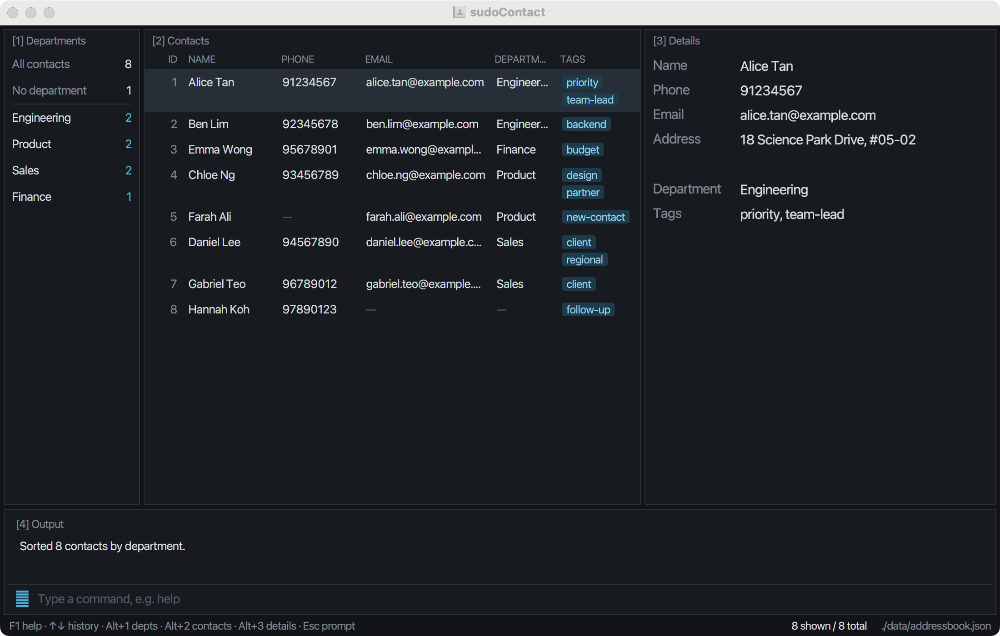
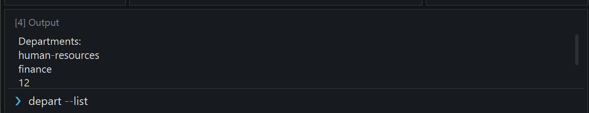
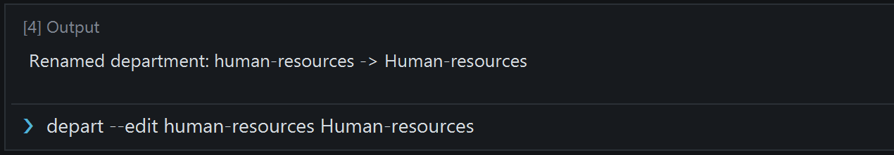
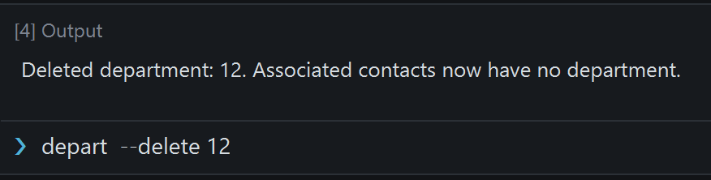
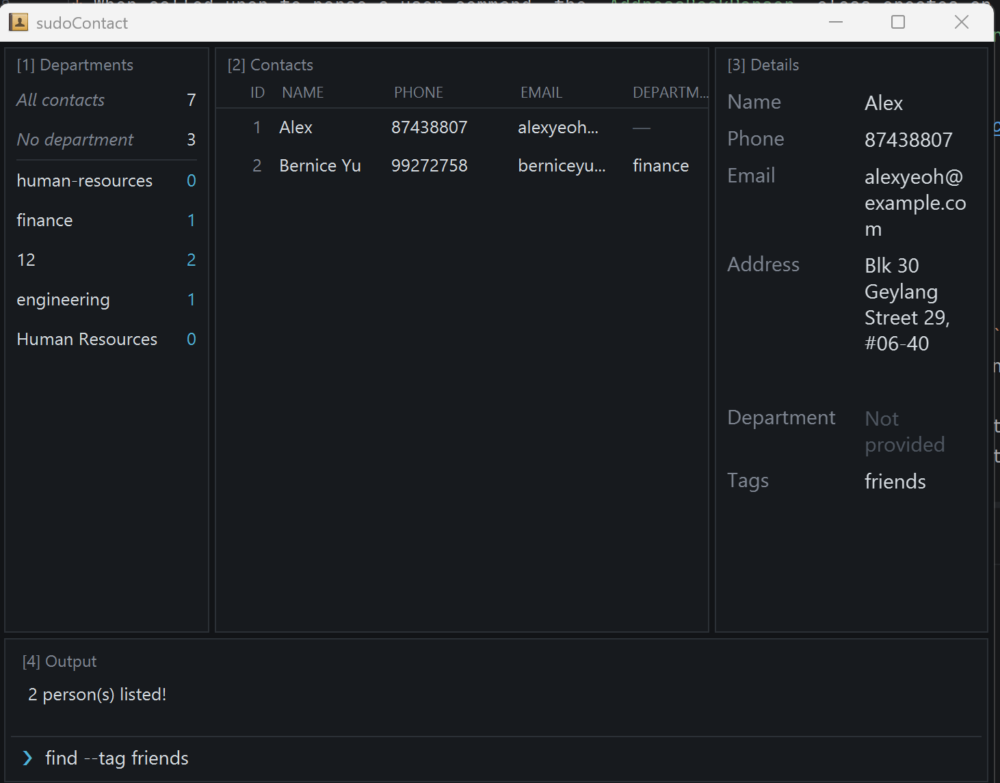

sudoContact helps secretaries supporting department heads in technology firms manage professional contacts.
It combines a **Command Line Interface (CLI)** for adding, finding and updating contacts with a graphical
view of departments and contact details. Contacts are stored locally, so the app works offline.

* Table of Contents
{:toc}

--------------------------------------------------------------------------------------------------------------------

## Quick start

1. Install Java `25` and run `java -version` in a terminal to confirm that this is the version being used.<br>
   **Mac users:** Ensure you have the precise JDK version prescribed [here](https://se-education.org/guides/tutorials/javaInstallationMac.html).

1. Download the latest `.jar` file from the [sudoContact releases](https://github.com/AY2627S1-CS2103T-W10-1/tp/releases).

1. Copy the file to a writable folder you want to use as the _home folder_ for sudoContact.
   The app needs permission to create its data and settings files there.

1. Open a terminal, `cd` to the folder containing the JAR file, and run `java -jar "sudoContact.jar"`.
   If the downloaded file has a different name, substitute its actual filename. Launch from the terminal
   each time to use the Java version you checked; double-clicking may use a different version or fail.<br>
   The four-pane window opens with sample contacts on first launch. The screenshot below uses illustrative
   contacts to show departments, sorting and full details.<br>
   

1. Type a command in the command box and press Enter to execute it. For example, type **`help`** and press Enter to open the scrollable command list. Press `q` while the Help window is active to close it.<br>
   Some example commands you can try:

   * `list` or `ls` : Lists all contacts.

   * `sort --by tags` : Sorts displayed contacts by their alphabetically smallest tag.

   * `add -n John Doe -p 98765432 -e johnd@example.com -a John street, block 123, #01-01` : Adds a contact named `John Doe` to the Address Book.

   * `delete 3` : Deletes the 3rd contact shown in the current list.

   * `clear` : Shows a warning with the total contact count. Use `clear --confirm` to delete all contacts and departments.

   * `exit` : Exits the app.

1. Refer to the [Features](#features) section below for details of each command.

--------------------------------------------------------------------------------------------------------------------

## Features

<div markdown="block" class="alert alert-info">

**:information_source: Notes about the command format:**<br>

* Words in `UPPER_CASE` are the parameters to be supplied by the user.<br>
  For example, in `add -n NAME`, replace `NAME` with a value such as `John Doe`.

* Items in square brackets are optional.<br>
  For example, `-n NAME [-t TAG]` can be used as `-n John Doe -t friend` or as `-n John Doe`.

* Items followed by `…`​ can appear zero or more times.<br>
  For example, `[-t TAG]…​` may be omitted, or written as `-t friend` or `-t friend -t family`.

* Named fields for `add` and `edit` can be in any order. Other commands follow their documented order.<br>
  For example, `-p PHONE_NUMBER -n NAME` is also acceptable for `add`. For `sort`, the option must precede the field.

* The field flags for `add` and `edit` each have a short and a long form:
  `-n`/`--name`, `-p`/`--phone`, `-e`/`--email`, `-a`/`--address`, `-t`/`--tag`, and `-d`/`--department` for `add` and `edit`.<br>
  Both forms can be used in the same command, for example `add --name John Doe -p 98765432`.

* A flag must be a separate word, with a space before it and a space (or the end of the command) after it.<br>
  For example, `-n John` sets the name, but `-nJohn` does not. Text such as `Blk 5 -apt 3` inside a value is kept
  as part of the value.

* For `add` and `edit`, quotes are optional. Wrap a value in matching single or double quotes when it contains a flag as a
  separate word, or a word starting with `--`.<br>
  For example, `edit 1 -a Blk 5 -t 3` sets the address to `Blk 5` and adds the tag `3`, while
  `edit 1 -a "Blk 5 -t 3"` sets the address to `Blk 5 -t 3`. A quote inside a word, as in `O'Brien`, needs no
  special treatment. Unmatched quotes and unknown options such as `--nme` are rejected.
  Other commands follow their own quoting rules; for example, quote a multiword department name in `depart`.

* Several tags can follow one tag flag, for example `-t friend family` or `--tag friend --tag family`.

* Flags are lowercase. Giving a single-valued field more than once, in either form, is an error that names both
  forms of the flag.<br>
  For example, `edit 1 -e a@example.com --email b@example.com` is rejected with a message naming `-e/--email`.

* Extraneous parameters for `exit` are ignored. `clear` accepts only the optional `--confirm` flag.<br>
  The `list` and `ls` commands reject extra parameters. Help accepts at most one known command name.

* Command words are case-insensitive, but parameters keep their case.<br>
  For example, `LIST` and `List` are interpreted as `list`, and `EDIT 1 -n "John Doe"` still sets the name to `John Doe`.

* If you are using a PDF version of this document, be careful when copying and pasting commands that span multiple lines as space characters surrounding line-breaks may be omitted when copied over to the application.
</div>

### Recalling command history

While the command box is focused, press **Up** to recall the last submitted command, then older commands.
Press **Down** to move toward newer commands. Moving past the newest command restores the draft
that was in the box before you started browsing. History stops at either end without wrapping.

You can edit a recalled command and press Enter to submit it again. Browsing does not execute commands.
Navigating away from an edited history entry discards those edits; the original history entry stays unchanged.
Successful and failed commands are remembered, including repeated submissions. Blank input is not stored.
History lasts only until you close the application and is not saved to disk.
When a command fails, the result box keeps the original error and shows up to two example commands
underneath it. These examples are shared with command help. Errors that already include examples
are shown without another examples section. Unknown commands suggest `help` instead.
Examples demonstrate valid syntax; an index, contact, filename, or storage problem may still need to be resolved.
The failed input stays in the command box so you can correct it.

### Navigating with the keyboard

The main window is split into numbered panes, and every pane can be reached from the keyboard.
The pane that has the keyboard focus is outlined.

Key | Action
----|-------
`Alt+1` | Focus **\[1\] Departments**, which counts all contacts, contacts with no department, and each department's contacts.
`Alt+2` | Focus **\[2\] Contacts**. Move with `↑`/`↓` or `j`/`k`; the selected contact appears in \[3\] Details. Press `Enter`, or double-click a contact, to open it in its own popup.
`Alt+3` | Focus **\[3\] Details**, which shows the selected contact. Press it again to step through the contact details popups; `q` closes the focused popup.
`Alt+4` or `Esc` | Return to the command prompt in **\[4\] Output**.
`F1` | Open the command help.

The contact list shows one row per contact. Fields that were not provided appear as `—`, and addresses are left
out to keep rows short; click a contact to see every field in \[3\] Details. The footer shows how many contacts are displayed out of all
stored contacts, and where the data file is saved.

### Viewing help: `help`

Opens a scrollable window listing every available command with a short description.
Command names and aliases appear in bold cyan beside short descriptions.
Supply a command name to view its syntax, supported options, examples, and behavior notes
in separate sections. Commands and option names are highlighted; use the **Copy** buttons
beside usage and examples to copy their text.
You can also open the overview from the Help menu or with `F1`.
Press unmodified `q` while the Help window is active to close it.

Format: `help [COMMAND]` or `? [COMMAND]`

Examples: `help`, `help depart`, `? sort`, `help ls`.

Command names are case-insensitive, and aliases (`ls` and `?`) are accepted as topics.
Unknown topics and multiple arguments are rejected. Repeated help requests update the same window,
and restore it if minimized. Help preserves contacts, the active filter, display order, and deletion history.
For example, `help clear` explains that confirmed clearing removes all contacts and registered departments,
including unused department entries.


### Adding a contact with partial information: `add`

Adds a contact with a name and at least one phone number or email address. You can fill in other details later.

Format: `add --name NAME [--phone PHONE] [--email EMAIL] [--department DEPARTMENT] [--address ADDRESS] [--tag TAG ...]`

* `--name` and at least one of `--phone` or `--email` are required. Names must be nonblank and contain
  only ASCII letters (`A-Z`, `a-z`), digits (`0-9`) or ordinary spaces. The current name format does not
  support accented or Chinese characters, apostrophes or hyphens; use an ASCII transliteration and spaces
  if needed. A name alone, even with an address, department or tags, is rejected with
  `A phone number or email address must be provided.`
* Options can appear in any order. Quotes around multiword values are optional:
  `--name "Alice Tan"` and `--name Alice Tan` are the same.
* Phone numbers must contain 7–15 digits, with no spaces or `+` sign.
* A supplied email must be valid, such as `alice@example.com`.
* Department names use the `depart` rules: 2-50 characters comprising English letters (`A-Z`, `a-z`),
  numbers, spaces, hyphens or `&`.
  Register the department first with `depart --add DEPARTMENT`; unknown names are rejected.
* Addresses are optional and must be nonblank when supplied.
* Tags contain 1–30 English letters (`A-Z`, `a-z`), numbers, hyphens or underscores. Leading `#` or `/` is removed.
  Repeat `--tag`, or put multiple tags after one flag. Identical tags are deduplicated; display preserves case.
* Omit an unknown field entirely. An option with an empty value is rejected.
* Unknown long options beginning with `--`, unmatched quotes and repeated options other than `--tag` are rejected.
  An unrecognised single-hyphen word inside a value is kept as text: `--address Road -x typo` stores
  the address `Road -x typo`. Recognised short flags such as `-t` start a new field unless quoted.
* In the contact table, missing values and tags appear as `—`. The addition feedback and full details show
  `Not provided` for omitted phone, email, address and department, and `None` for no tags.
* A contact with the same name as an existing contact and the same provided phone number **or** email address
  is a duplicate and is rejected. Missing fields do not match; address, department and tags are not compared.
  Names and emails are compared case-sensitively; phone numbers are compared exactly.

Short flags also work, and can be mixed with long ones:
`add -n NAME [-p PHONE] [-e EMAIL] [-d DEPARTMENT] [-a ADDRESS] [-t TAG ...]`.

Examples:

* `add --name "Alice Tan" --email alice@example.com`
* `add --name "Bob Lee" --phone 91234567`
* `depart --add Engineering`, then `add --name "Chen Wei" --phone 91234567 --department Engineering --tag intern new-client`
* `add --name "Dana Lim" --email dana@example.com`
* `add -n Betsy Crowe -t friend -e betsycrowe@example.com -a Newgate Prison -p 1234567 -t criminal`

To complete a contact, find their name and use the displayed row number with the existing commands,
for example, register Engineering with `depart --add Engineering`, then run `find Dana` followed by
`edit 1 -p 91234567 -e dana@example.com --department Engineering`.
Contacts are saved automatically and retain their supplied and omitted fields after restarting.
Successful addition clears the active filter and sorting, and shows all contacts in stored order.
If saving fails, an error is shown, but the new contact remains in the current session's list; saving has
not been confirmed. Repeating the same `add` may therefore report a duplicate. Resolve the reported
storage problem, then run `list` to retry saving before closing the app.

### Listing all contacts: `list` or `ls`

Shows all contacts in their stored order, clearing the current filter and display sorting.

Format: `list` or `ls`

* Both commands take no parameters.
* Leading and trailing spaces are ignored.
* Command words are case-insensitive: `LIST`, `List`, and `LS` are also accepted.
* Extra parameters produce: `The list command does not accept any parameters. Usage: list | ls`

Examples:

* `list`
* `ls`
* `find Betsy` followed by `ls` restores the full contact list.

### Managing departments: `depart`

Manages the shared department catalogue. Choose one operation per command:

| Command | Result |
| --- | --- |
| `depart --list` | Lists every registered department, including unused departments. |
| `depart --delete DEPARTMENT` | Removes a department and clears its assignments on all contacts, including hidden contacts. |
| `depart --add DEPARTMENT` | Registers a new department without assigning contacts. |
| `depart --edit OLD_NAME NEW_NAME` | Renames a department and updates every associated contact, including hidden contacts. |

* Names are case-sensitive and must contain 2-50 characters using English letters (`A-Z`, `a-z`), numbers,
  spaces, `-`, or `&`.
  `depart`, `add`, and `edit` trim surrounding whitespace before validation and catalogue lookup.
  Spaces inside quoted names are preserved. Existing saved names are normalized on loading.
  Blank names are rejected. Quote names containing spaces, e.g. `depart --add "Customer Support"`.
* Adding an existing name, renaming an unknown source, or renaming to another existing name fails without changes.
  Renaming a department to its current name is allowed and leaves its name unchanged.
* Names and assignments are saved across restarts. When loading older data, existing contact departments are
  automatically registered. `clear` removes both contacts and the catalogue.
* `depart --list` preserves contact filtering and sorting and does not write to storage.
  Renaming preserves the filter and resets contact sorting to stored order.
* Renaming also updates deleted contacts retained for `undo`, so restoring a contact uses the new department name.

Deleting a department preserves all contacts and their other fields, but clears matching department
assignments in both current contacts and contact deletion history. The deletion is added to the same
session-only undo history as contact deletions. See [Undoing a deletion](#undoing-a-deletion-undo).
`undo` restores the removed department and its original assignments where the contacts still have no department.
Later edits to other contact fields are preserved; contacts explicitly assigned elsewhere are not reassigned.
Deletion retains the current filter, resets sorting to stored order, and is saved across restarts.

Use `depart --delete "Customer Support"` to remove a registered department. Success reports
`Deleted department: Customer Support. Associated contacts now have no department.`
An unknown name reports `Department does not exist: NAME. Use depart --list or depart --add DEPARTMENT.`
Missing names, extra arguments, blank names and invalid names are rejected without changing contacts or history.

For example, run `depart --add Engineering`, then `depart --edit Engineering "Research & Development"`.
`depart --list` now includes `Research & Development` even if no contacts belong to it.

Use `depart --list` to verify all registered departments, including departments that currently have no contacts:



Renaming a department reports both its previous and updated names:



Deleting a department confirms that its associated contacts now have no department:



### Assigning a contact's department: `edit --department`

Format: `edit CONTACT_ID --department DEPARTMENT` (short form: `edit CONTACT_ID -d DEPARTMENT`).

* `CONTACT_ID` is the positive row number in the currently displayed list, including after filtering or sorting.
* The department must already exist in `depart --list`. An unknown name rejects the entire edit, including
  other supplied fields. Register new names with `depart --add` first.
* Assignment changes only the selected contact. Omitted departments remain unchanged; departments are optional.
* A successful edit shows all contacts in stored order. Check the displayed indices before the next command.
* The previous `depart CONTACT_ID --set DEPARTMENT` syntax is no longer supported.

Examples (register the named departments first):

* `edit 1 --department Engineering`
* `edit 2 -d "Customer Support"`
* `sort --by tags`, then `edit 1 -d Marketing`, assigns Marketing to the first sorted contact.

Use `sort --by department` after assignments to group contacts by department.

### Sorting contacts by department or tags: `sort`

Sorts the currently displayed contacts in ascending order while preserving any active `find` filter.

Format: `sort -b FIELD` or `sort --by FIELD`

* `FIELD` must be `department`, `dept`, `tag`, or `tags`. The aliases select the same two sorting fields.
* Department and tag comparisons are alphabetical and case-insensitive.
* Tag sorting uses each contact's alphabetically smallest tag, not the order tags were entered.
  It does not group contacts by every tag they share; a contact appears once, using its smallest tag as the key.
* Contacts without the selected field appear last. Equal sorting keys retain their current relative order,
  including case-only differences and when switching sorting fields; names are not a tie-breaker.
* Department sorting uses the stored department assigned with `edit CONTACT_ID --department DEPARTMENT`.
  Contacts without departments appear last.
* Successful sorting reports the number of displayed contacts and the selected field in one line.
* Only the display order changes. Contacts and their saved order remain unchanged, and sorting does not save the file.
* Displayed indices are updated; `edit 1`, `delete 1`, and `view 1` target the first row.
* Another sort uses the current displayed order as its starting point. `list`, `find`, and successful contact
  mutations (`add`, `edit`, `delete`, `depart --edit`, `depart --delete`, `clear`, or `undo`) reset sorting to stored order.
  `depart --list` and `depart --add` preserve sorting.
  `view` and `help` preserve the display order. Sort order is not retained after restarting.
* Options and field aliases are lowercase. Use ordinary hyphens, not Unicode dashes. Exactly one option and one
  field are required; quoted fields, `--by=tags`, combined options, extra arguments, and descending order are rejected.

Examples:

* `sort -b department`
* `sort -b dept`
* `sort --by tag`
* `sort --by tags`

For example, start with Alex Tan, Beatrice Lim, and Chen Wei in that stored order:

Contact | Department | Tag
--------|------------|----
Alex Tan | Engineering | mentor
Beatrice Lim | Marketing | client
Chen Wei | Engineering | intern

`sort --by tags` displays Beatrice, Chen, then Alex and returns:

```text
Sorted 3 contacts by tags.
```

Starting again from stored order, `sort -b dept` displays Alex, Chen, then Beatrice and returns:

```text
Sorted 3 contacts by department.
```

Alex and Chen retain their relative order because their department keys are equal.
The reported count includes only contacts in the currently displayed list.

For an empty displayed list, the feedback is `No contacts found to sort.`

Problem | Feedback
--------|---------
Missing option | `Missing sorting option. Usage: sort -b/--by <department\|dept\|tag\|tags>`
Missing field | `Missing sorting field. Usage: sort -b/--by <department\|dept\|tag\|tags>`
Unknown field | `Invalid sorting field. Use department, dept, tag, or tags.`
Unsupported or repeated argument | `Unsupported argument. Usage: sort -b/--by <department\|dept\|tag\|tags>`
`--descending` supplied | `Descending order is not supported. Contacts are sorted in ascending order.`
Invalid displayed contact data | `Unable to sort contacts because some stored contact data is invalid.`

When several input problems occur, an explicit `--descending` token takes precedence, followed by unsupported
argument structure, missing option/value, and an invalid field. Failed input or invalid sorting data leaves the
current display order unchanged. Sorting preserves separate contact occurrences rather than deduplicating them;
the application's existing rules still prevent duplicate contacts from being added.

Sorting uses the current in-memory contacts; it does not reread the file. If contacts fail to load at startup,
the application starts with an empty list, so sorting reports `No contacts found to sort.` You can add valid contacts
and sort them in the same session. To load contacts from a repaired file, restart the application.
A missing file follows the existing sample-data behavior.

### Viewing a contact's details: `view`

Shows the selected contact's name, phone, email, department, address and tags in a contact details popup.
The main result box shows a brief confirmation, such as `Showing details of contact 1: Amy Bee`.
To glance at a contact without opening a popup, click it in the contact list; its details appear in \[3\] Details.
The popup lists each field name beside its value, with how to reach the contact (name, phone, email, address)
grouped above how they are organised (department, tags). Long values wrap onto multiple lines; scroll to read them.
Contacts without tags show a dimmed `None` for Tags, and contacts without a department show a dimmed `Not provided`.
To copy a value, press `Alt+3` until the popup (or \[3\] Details) has the focus, use `j`/`k` (or `Tab`, `↑`/`↓`) to
select a value, then press `Ctrl+C` (`Cmd+C` on macOS).
You can also click a popup's title bar instead of pressing `Alt+3`, then use `j`/`k`.

Format: `view CONTACT_ID`

* `CONTACT_ID` is the positive integer shown beside a contact in the **currently displayed list**.
* After filtering or sorting, use the current displayed `CONTACT_ID`, rather than its position in the saved address book.
* Surrounding spaces are ignored. Missing contact IDs, zero, negative numbers, decimals and extra arguments are rejected.
* A contact ID outside the displayed list produces an error showing the valid range.
* An empty displayed list produces `There is no contact to view in the currently displayed list.`
* Viewing is read-only: it preserves contact data, the current filter and display order without saving the JSON file.
  It still works if the contact file cannot currently be written.
* Each contact gets its own popup, so you can view several contacts and compare them side by side.
  Viewing a contact that already has a popup updates that popup instead of opening another one,
  even if you have since edited the contact's name, phone or email.
* The command prompt keeps the keyboard focus after `view`, so you can keep typing. Press `Alt+3` to move to
  \[3\] Details and then into the popups. Unmodified `q` closes only the focused popup and returns focus to the
  command prompt; `Esc` returns to the prompt without closing the popup.
* A popup shows a snapshot. Run `view CONTACT_ID` again after editing, deleting or filtering to refresh it.
  Closing a popup does not exit sudoContact; exiting sudoContact closes every popup.
* You can also double-click a contact in the contact list, or select it and press `Enter`, as described in
  [Navigating with the keyboard](#navigating-with-the-keyboard).

Examples:

* `list` followed by `view 2` shows the second contact in the full list.
* After registering Engineering, use `edit CONTACT_ID --department Engineering` to assign it.
  Since editing resets the displayed list, find the contact again and use its current row number with `view`.
* `find Betsy` followed by `view 1` shows the first contact in the search results.

### Editing a person: `edit`

Edits an existing person in the address book.

Format: `edit INDEX [-n NAME] [-p PHONE] [-e EMAIL] [-a ADDRESS] [-d DEPARTMENT] [-t TAG]…​`

* Edits the person at the specified `INDEX`. The index refers to the index number shown in the displayed person list. The index **must be a positive integer** 1, 2, 3, …​
* At least one of the optional fields must be provided.
* Existing values will be updated to the input values.
* New values follow the same rules as in `add`. For example, a phone number must contain 7–15 digits, and a
  leading `#` or `/` is removed from each tag.
  Names use the same ASCII-only format, and name/email duplicate comparisons are case-sensitive.
  Unknown `--` options are rejected; unrecognised single-hyphen words inside values remain literal text.
* `-d`/`--department` accepts only a registered department; use `depart --list` to see available names.
  If a supplied department is unknown, no fields are changed.
* After a successful edit, the full list is shown in stored order.
* When editing tags, all of the person's existing tags are removed; adding tags is not cumulative.
* To remove all of a person's tags, enter `-t` without a tag after it.

If saving an edit fails, the changed contact remains in memory even though saving has not been confirmed.
Resolve the storage problem and run `list` to retry saving before closing; the edit is not rolled back.

Examples:
*  `edit 1 -p 91234567 -e johndoe@example.com` Edits the phone number and email address of the 1st person to be `91234567` and `johndoe@example.com` respectively.
*  `edit 2 -n Betsy Crower -t` Edits the name of the 2nd person to be `Betsy Crower` and clears all existing tags.

### Locating contacts by tags: `find --tag`

Format: `find --tag TAG [TAG ...] [--tag TAG ...]`

* Command words are case-insensitive: `find`, `FIND`, and `FiNd` are equivalent.
* The option must be lowercase `--tag`; `--TAG` is invalid. Tag matching is case-insensitive:
  `friends` matches `Friends`. Original tag spelling is preserved in stored data and display.
* Matches contacts with **any** of the specified tags, ignoring case and matching whole tags.
* Each matching contact is displayed once, even if several tags match or a tag is repeated.
* As with `add` and `edit`, several tags can follow one `--tag`, the option can be repeated, and identical
  inputs are deduplicated. Leading `#` or `/` characters are removed before searching.
* Tags use English letters (`A-Z`, `a-z`), numbers, hyphens (`-`), or underscores (`_`), without spaces.
  New tags are limited to 30 characters, but search also accepts longer tags retained from older data files.
  Quote a tag that is itself an option-like value, e.g. `find --tag "--tag"` searches for the tag `--tag`.
* A missing value displays `Tag cannot be empty: Please provide a valid tag after '--tag'.`
* An invalid search value displays `Tags must use only letters, numbers, hyphens (-), and underscores (_), with no spaces.`
* No matches displays `No contacts found with the specified tag(s).`
* Searching changes only the displayed list; it does not modify contacts or save the JSON data file.

Example: `find --tag client --tag important`

For example, `find --tag friends` displays the two contacts tagged `friends` and reports the number of matches:



For `depart --add`, `depart --edit` and `depart --delete`, each department name containing spaces
must be enclosed in matching single or double quotes, e.g. `depart --add "Customer Support"`.
Matching quotes around tag-search values are optional, except when needed to prevent a value such as `--tag`
from being interpreted as an option.

### Locating persons by name: `find`

Finds persons whose names contain any of the given keywords.

Format: `find KEYWORD [MORE_KEYWORDS]`

* The search is case-insensitive; for example, `hans` matches `Hans`.
* Matching single or double quotes around name keywords are optional: `find "Alex Yeoh"`
  and `find 'Alex Yeoh'` behave like `find Alex Yeoh`. Quotes do not request an exact phrase match.
  Empty quoted input and unmatched quotes are rejected.
* Keyword order does not matter; for example, `Hans Bo` matches `Bo Hans`.
* The search considers only names.
* Only full words match; for example, `Han` does not match `Hans`.
* Persons matching at least one keyword are returned (an `OR` search); for example, `Hans Bo` returns `Hans Gruber` and `Bo Yang`.

Examples:
* `find John` returns `john` and `John Doe`
* With the initial sample contacts, `find alex david` returns `Alex Yeoh` and `David Li`.

### Deleting a person: `delete`

Deletes the specified person from the address book.

Format: `delete INDEX`

* Deletes the person at the specified `INDEX`.
* The index refers to the index number shown in the displayed person list.
* The index **must be a positive integer** 1, 2, 3, …​
* You can restore a deleted person with `undo`.

Examples:
* `list` followed by `delete 2` deletes the 2nd person in the address book.
* `find Betsy` followed by `delete 1` deletes the 1st person in the results of the `find` command.

### Undoing a deletion: `undo`

Restores the most recent contact deletion (`delete INDEX`) or department deletion (`depart --delete NAME`).

Format: `undo`

* Both deletion types share one history. Repeated calls undo deletions in reverse chronological order.
  `add`, `edit`, `depart --add`, `depart --edit`, and `clear` cannot be undone.
* History is remembered only until you close the app. Successful undo is saved and shows all contacts in stored order.
* Undoing a contact deletion appends the restored contact to the list. It fails if a
  [duplicate](#adding-a-contact-with-partial-information-add) of that contact now exists. The deletion stays in the
  history, so you can edit or delete the duplicate and retry.
* A restored contact must have a phone number or email address. If a deleted legacy contact has neither,
  `undo` reports `A phone number or email address must be provided.` and leaves data and history unchanged.
  You can recreate that contact using `add` with the required contact information.
* Undoing a department deletion restores the catalogue entry and the original assignments on existing contacts
  and contacts in deletion history. It preserves later edits to other fields and does not overwrite a department
  assigned after the deletion. Contacts removed by `clear` are not recreated.
* If the department name has been registered again, undo fails with
  `Cannot restore the deleted department because it already exists: NAME`. No data or history is changed.
  Rename the conflicting entry with `depart --edit` before retrying.
* Department restoration reports `Restored deleted department: NAME`.
* `undo` takes no parameters. With no history, it reports `There are no deletions to undo in this session.`

Examples:

* `depart --delete Engineering`, then `undo` restores Engineering and its eligible contact assignments.
* `delete 1`, `depart --delete Engineering`, then `undo` restores Engineering first.
  A second `undo` restores the deleted contact with its original Engineering assignment.
* `depart --delete Engineering`, `delete 1`, then `undo` restores the contact without a department.
  A second `undo` restores Engineering and the contact's original assignment.

### Clearing all entries: `clear`

Deletes all contacts **and the entire department catalogue** only when explicitly confirmed.
The clear operation cannot be undone.
Earlier individual deletions remain available to `undo` during the current session.

Format: `clear [--confirm]`

* `clear` shows a warning without changing contacts, the department catalogue, or the saved address book:
  `This will delete all N contacts and all registered departments and cannot be undone. Type "clear --confirm" to proceed.`
* `N` counts **all stored contacts**, including contacts hidden by a search.
* `clear --confirm` deletes all stored contacts and all registered departments, including unused entries,
  and saves the empty address book immediately.
  It can be entered directly without first entering `clear`.
* The empty address book is saved **before** contacts and departments are removed from this session.
  If saving fails, clearing is not applied: contacts, departments, the current filter and sorting, and earlier
  deletion history remain unchanged. The error explains that the data remains available in this session.
  Resolve the save error, then retry `clear --confirm` to clear the data, or run `list` to save the retained data.
  A write interrupted partway through may leave an incomplete JSON file; keep the app open until you can
  successfully save the retained data. Successful clearing still cannot be undone.
* Only the exact lowercase flag `--confirm` is accepted. Surrounding whitespace is allowed.
  Other arguments, such as `clear 1`, `clear --CONFIRM`, or `clear --confirm extra`, show an
  invalid command format error without deleting or saving anything.
* With no contacts, `clear` still shows a warning with a count of 0, even if registered departments remain.
  The warning still states that all registered departments will be deleted.

Examples:
* `clear` shows the warning and leaves all contacts and registered departments unchanged.
* `clear --confirm` deletes all contacts, including those hidden by the current filter, and all registered
  departments, including unused entries.

### Exiting the program: `exit`

Exits the program.

Format: `exit`

### Exporting contacts as CSV: `export`

Creates a CSV copy of **all stored contacts**, including contacts hidden by a search.
Export does not change your contacts or the displayed list.

Format: `export -c|--csv [FILENAME]`

* Omit `FILENAME` to use `contacts.csv`. Use either `-c` or `--csv` before the filename.
* Use a filename ending in lowercase `.csv`, without a folder path. Surround a filename containing spaces
  with matching double or single quotes, for example `export --csv "my contacts.csv"`.
* Filenames cannot be empty or contain `< > : " / \ | ? *` or control characters. Leading or trailing spaces
  and reserved device names such as `CON.csv`, `NUL.csv` and `COM1.csv` are rejected.
* The file is created in the folder from which you launched the app. Following the Quick start instructions,
  this is the folder containing the JAR file.
* Existing files are never overwritten. Choose another filename or move the existing file before retrying.
* The UTF-8 file starts with `Name,Phone,Email,Department,Address,Tags`. Each stored contact gets one row,
  in stored order, even if several records have the same name. Missing details produce empty cells.
  Tags appear alphabetically in one cell, separated by `; `. Commas, quotes and line breaks within a value
  are preserved using CSV quoting. Phone numbers retain their original digits in the file; when importing
  into a spreadsheet, select a text column to keep leading zeroes.

Examples:

* `export --csv` creates `contacts.csv`.
* `export -c team.csv` creates `team.csv` using the short option.
* `find John` followed by `export --csv team.csv` still exports every stored contact.
* `export --csv "my contacts.csv"` creates `my contacts.csv`.

Success: `Exported 3 contacts to contacts.csv.` (the count reflects your stored contacts).
An empty address book reports `No contacts found to export.` and creates no file.
Invalid syntax reports the command format. Invalid filenames identify the violated rule:

| Input | Feedback |
| --- | --- |
| `export --csv Team.CSV` | `Invalid file name: the extension must be lowercase .csv.` |
| `export --csv con.csv` | `Invalid file name: 'con' is a reserved device name. Choose another name.` |
| `export --csv ../x.csv` | `Invalid file name: folder paths are not allowed. Provide a filename only.` |

Missing filename stems, surrounding whitespace, reserved characters and control characters also produce
specific correction messages. If the folder is unavailable,
unwritable or out of space, the app reports that it cannot create the CSV; choose a writable launch folder
or free space and retry. Export is a copy for external use; it does not replace the app's JSON data file.

### Saving the data

sudoContact automatically saves contact changes after successful commands; no separate save command is needed.
The JSON save is skipped for `find`, `view`, `sort`, `export`, `help`/`?`, `depart --list`, and `clear`
without `--confirm`.
`sort` changes only the displayed order; it does not write the contact file or persist the sort order.
`export` writes a separate CSV copy; it does not modify or save the JSON contact file.
Finding, viewing, help and department listing only display information; unconfirmed `clear` only displays its warning.
`clear --confirm` does save the cleared data. `list`/`ls` retains the normal JSON-save behavior.
Departments and tags are contact data and are saved normally when changed.

### Editing the data file

Contact data is saved as `data/addressbook.json` relative to the terminal's current working directory when
the app is launched. `preferences.json` is also relative to that directory. Following Quick start by first
using `cd` makes this the folder containing the JAR. Launching the JAR by its full path from another folder
uses that other folder for data instead. Advanced users may edit the JSON file while the app is closed;
check the launch directory before copying or changing it.

<div markdown="span" class="alert alert-warning">:exclamation: **Caution:**
If your changes make the data file invalid, sudoContact starts with an empty address book at the next run. The invalid file remains on disk until a successful command that saves data overwrites it. `sort` uses the current in-memory contacts without writing the file; failed commands also do not save. Still, we recommend backing up the file before editing it.<br>
Furthermore, certain edits can cause sudoContact to behave in unexpected ways (e.g., if a value entered is outside of the acceptable range). Therefore, edit the data file only if you are confident that you can update it correctly.
</div>

### Backing up and moving data

Close sudoContact before copying or replacing data. Copy `data/addressbook.json` from the launch folder
into a separate backup location; this file contains both contacts and the department catalogue.
To restore or move it, close the destination app and place the copy at the same relative path in its
launch folder, creating `data/` if necessary. Restart and check the contacts and departments.

`preferences.json` stores settings, not contacts. A CSV export is useful for sharing contact information,
but sudoContact has no CSV import command, so use the JSON file for a restorable backup.

--------------------------------------------------------------------------------------------------------------------

## FAQ

**Q**: How do I transfer my data to another computer?<br>
**A**: Follow [Backing up and moving data](#backing-up-and-moving-data). Keep the original JSON backup until
contacts and departments have been verified on the new computer.

--------------------------------------------------------------------------------------------------------------------

## Known issues

1. **Off-screen windows after changing displays:** Close the app, rename `preferences.json` in the launch
   folder to `preferences.backup.json`, and launch again to reset the saved window position.
   This resets preferences without deleting `data/addressbook.json` or its contacts.
2. **macOS fullscreen dialogs:** Keep Help and contact-details popups in their normal window mode.
   Making an auxiliary window fullscreen can cause unexpected focus or window behavior.

--------------------------------------------------------------------------------------------------------------------

## Command summary

Action | Format, Examples
--------|------------------
**Add** | `add --name NAME [--phone PHONE] [--email EMAIL] [--department DEPARTMENT] [--address ADDRESS] [--tag TAG ...]`<br> or `add -n NAME [-p PHONE] [-e EMAIL] [-d DEPARTMENT] [-a ADDRESS] [-t TAG]…` <br> e.g., `add --name "James Ho" --email jamesho@example.com`
**Clear** | `clear` (warning), `clear --confirm` (delete all contacts and registered departments)
**Delete** | `delete INDEX`<br> e.g., `delete 3`
**Edit** | `edit INDEX [-n NAME] [-p PHONE_NUMBER] [-e EMAIL] [-a ADDRESS] [-d DEPARTMENT] [-t TAG]…​`<br> e.g., `edit 2 -n James Lee -e jameslee@example.com`
**Find by name** | `find KEYWORD [MORE_KEYWORDS]`<br> e.g., `find James Jake`
**Find by tag** | `find --tag TAG [TAG ...] [--tag TAG ...]`<br> e.g., `find --tag client --tag important`
**Export** | `export --csv [FILENAME]` or `export -c [FILENAME]`<br> e.g., `export -c team.csv`
**View** | `view CONTACT_ID`<br> e.g., `view 2`
**List** | `list` or `ls`
**Depart** | `depart --list`, `depart --add DEPARTMENT`, `depart --edit OLD_NAME NEW_NAME`, or `depart --delete DEPARTMENT`<br> e.g., `depart --edit Engineering "Research & Development"`
**Sort** | `sort -b FIELD` or `sort --by FIELD`, where `FIELD` is `department`, `dept`, `tag`, or `tags`
**Undo** | `undo`
**Help** | `help [COMMAND]` or `? [COMMAND]`
